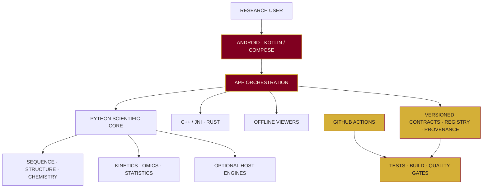

<!-- KINETICS · ASSAYFLUX SCIENTIFIC SYSTEMS -->

  <table>
    <tr>
      <td align="center" width="33%">
        
      </td>
      <td align="center" width="34%">
        
      </td>
      <td align="center" width="33%">
        
      </td>
    </tr>
  </table>

<h1 align="center">KINETICS</h1>

  <strong>OFFLINE-FIRST SCIENTIFIC RESEARCH WORKBENCH</strong> 
  ASSAYFLUX SCIENTIFIC SYSTEMS

  
  
  
  

  <em>Every helix carries a question. Every answer carries its evidence.</em>

---

## ◈ THE PROJECT

**Kinetics** is an open-source scientific research workbench developed by **AssayFlux Scientific Systems**. It brings an Android-native application together with a Python research core and selected native components, using versioned contracts and a capability registry to organise scientific workflows.

Its engineering priorities are **reproducibility, provenance, bounded inputs, offline-first operation and honest evidence**.

PROJECT MATURITY · Research-platform engineering prototype. Not a clinically validated platform.

## ◈ RESEARCH DOMAINS

<table>
  <tr>
    <td width="50%" valign="top">
      <h3> Sequence &amp; Genomics</h3>
      FASTA/FASTQ parsing, quality control, sequence utilities and research-only variant/PGx foundations.
    </td>
    <td width="50%" valign="top">
      <h3> Structural Biology</h3>
      PDB/mmCIF parsing, contacts, RMSD and bounded structure-analysis foundations.
    </td>
  </tr>
  <tr>
    <td valign="top">
      <h3> Chemistry &amp; Docking</h3>
      Molecular graph and format utilities, with optional RDKit and AutoDock Vina integrations.
    </td>
    <td valign="top">
      <h3> Kinetics &amp; Dynamics</h3>
      Enzyme-kinetics foundations and optional molecular-dynamics integration through OpenMM.
    </td>
  </tr>
  <tr>
    <td valign="top">
      <h3> Omics &amp; Statistics</h3>
      Exploratory data-analysis, statistical and synthetic-cohort utilities.
    </td>
    <td valign="top">
      <h3> Evidence &amp; Governance</h3>
      Capability registry, schemas, provenance, source inventory and validation controls.
    </td>
  </tr>
</table>

  

## ◈ ENGINEERING

| LAYER | TECHNOLOGY |
|:--|:--|
| Android | Kotlin · Jetpack Compose · AndroidX · Gradle |
| Scientific core | Python 3.10+ · pytest · Ruff · mypy |
| Native | C++17 · JNI/NDK · Rust |
| Optional engines | RDKit · AutoDock Vina · OpenMM |
| Viewer & worker | HTML5 · CSS · JavaScript · WebView · Node.js |
| Data & contracts | SQLite · JSON Schema · YAML · SPDX |

  

## ◈ SYSTEM ARCHITECTURE

## ◈ TRACK SEQUENCE & STATUS

**Current order — D-023 (12 November 2026):**  
**R → S → I → P → G → U**

Each track follows the same two-step gate: **build the documented base → audit, test and close software gaps**. External evidence remains separately gated.

| TRACK | SOFTWARE POSITION | REMAINING GATE |
|:---:|:--|:--|
| **R** | Software scope closed | Scientific, device, licensing and release evidence carry forward. |
| **S** | Software scope closed | Independent scientific, licensed-resource and device evidence carry forward. |
| **I** | Software scope closed | Scientific benchmarks, licensing, secure-node and device evidence carry forward. |
| **P** | In progress | Exact-head verification; P0 remains **BLOCKED / NOT APPROVED**. |
| **G** | Baseline drafted; sequential implementation gated | P verification, then G build/audit and independent operating evidence. |
| **U** | Partial U0–U3 baseline retained | Further work follows G's two-step gate assessment. |

Track status is a concise roadmap summary, not a percentage-compliance claim. A green software workflow does not establish scientific validity, clinical suitability or physical-device verification.

## ◈ CURRENT LIMITATIONS

- Research-only scope. No patient-data workflow or Clinical Decision Support Mode is authorised.
- P0 is **NOT APPROVED**. Its external legal, ethics, clinical, privacy, security and regulatory determinations remain outstanding.
- Host tests and synthetic fixtures do not establish biological, clinical or device validity.
- Optional engines, datasets, models and fonts require separate upstream licence and redistribution review.
- No production deployment or signed public release is claimed.

## ◈ DESIGN REFERENCES

<table>
  <tr>
    <td align="center" width="50%">
      
      <strong>DASHBOARD</strong> · DESIGN REFERENCE
    </td>
    <td align="center" width="50%">
      
      <strong>LOGIN</strong> · DESIGN REFERENCE
    </td>
  </tr>
</table>

## ◈ PROJECT DOCUMENTS

  
  
  
  
  
  

## ◈ CONTRIBUTING

1. Read the [North Star](NORTH_STAR.md), [Roadmap](ROADMAP.md) and [Decision Log](DECISIONS.md).
2. Follow [CONTRIBUTING.md](CONTRIBUTING.md) and the active track's acceptance criteria.
3. Include tests, schemas, provenance and licensing evidence with substantive changes.
4. State exactly what was tested, what was not tested and what remains open.

## ◈ LICENSE

**Apache License 2.0.** See [LICENSE](LICENSE). Third-party dependencies, engines, datasets, models, fonts and artwork may carry separate terms.

---

  

  <strong>ASSAYFLUX SCIENTIFIC SYSTEMS</strong> 
  BUILT FOR RESEARCH · GUIDED BY EVIDENCE

  

  © ASSAYFLUX · KINETICS

