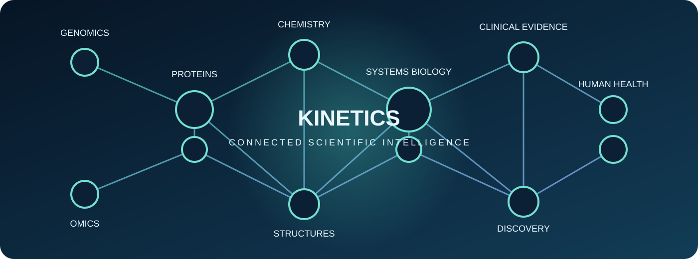
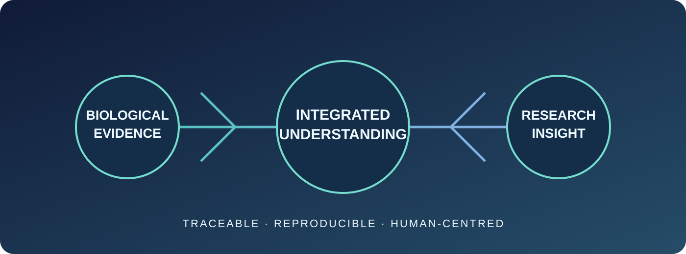
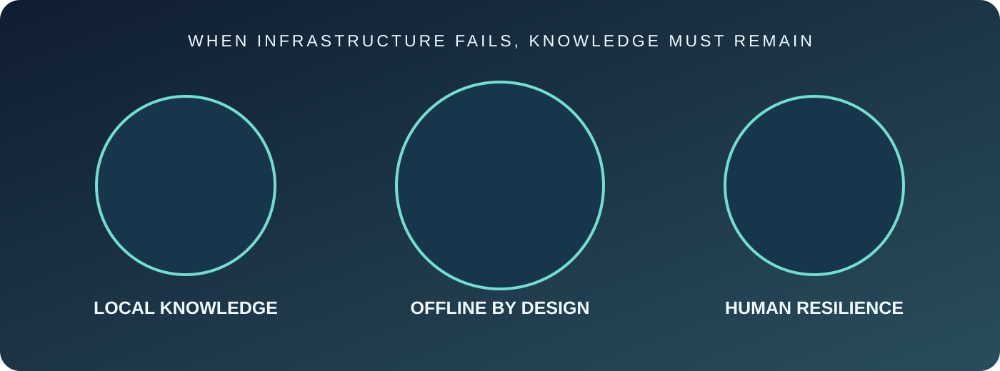
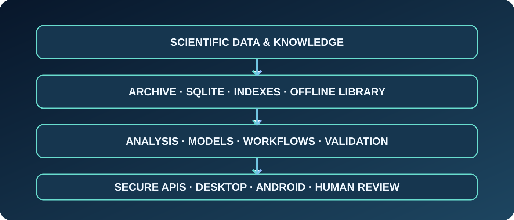

# KINETICS
### CONNECTING SCIENCE · ADVANCING HEALTH · PROTECTING HUMANITY

**A long-horizon scientific and biomedical intelligence infrastructure for discovery, precision-health research and human resilience.**

[Mission](KINETICS_MISSION.md) · [Vision](VISION.md) · [Roadmap](ROADMAP.md) · [Architecture](ARCHITECTURE.md) · [Emergency Resilience](docs/EMERGENCY_HUMANITARIAN_RESILIENCE.md)

---

  

## The idea behind Kinetics

Humanity has accumulated extraordinary knowledge about life: genomes, proteins, molecular structures, chemical compounds, cellular systems, diseases, medicines, clinical studies and the environments in which people live. Yet much of this knowledge remains fragmented across disciplines, databases, formats, institutions and technical systems.

**Kinetics is being built to connect that knowledge.**

Our long-term ambition is to create an extensible, evidence-centred scientific platform that can integrate biological and biomedical information, preserve its provenance, connect meaningful relationships, support reproducible analysis and make trusted knowledge more accessible. It is intended to serve scientific discovery and responsible healthcare research—and to preserve essential knowledge when normal infrastructure is unavailable.

Kinetics is not merely a single-purpose enzyme-kinetics application, a database browser or a chatbot. It is a foundation for a broad ecosystem of scientific data, computational methods, validated models, research workflows and future applications.

> **Our north star:** build scientific infrastructure that helps humanity understand life, investigate disease, advance responsible medicine and preserve knowledge for the most difficult circumstances.

## Our mission

To advance human health and survival by connecting biological, biomedical and scientific knowledge into an integrated, accessible, evidence-centred and resilient platform.

Kinetics aims to help researchers and qualified professionals:

- Investigate biological systems from genes and molecules through cells, tissues, organs and populations.
- Connect genetic variation to transcripts, proteins, structures, pathways, molecular function and phenotypes.
- Explore biochemical mechanisms, chemical biology, pharmacology and therapeutic hypotheses.
- Integrate multi-omics, physiology, disease biology, clinical literature and population-level evidence.
- Study why biological characteristics and treatment responses differ across individuals and populations.
- Develop reproducible research workflows with transparent assumptions, uncertainty and limitations.
- Access curated scientific and health reference material locally, including during prolonged network outages.

The mission is to make scientific knowledge more connected and useful—not to replace scientific judgment or qualified healthcare.

## Our vision: a connected intelligence ecosystem for life sciences

  

We envision Kinetics evolving into a comprehensive scientific infrastructure that can connect many layers of life and health:

### 1. Molecular and genetic understanding
Genomes, genes, regulatory regions, variants, transcripts, epigenetics, protein sequences, domains, structures, complexes, folding, molecular dynamics and functional interactions.

### 2. Chemistry and therapeutic research
Small molecules, natural products, metabolites, reactions, molecular properties, target interactions, enzyme kinetics, pharmacology, pharmacokinetics, pharmacodynamics and safety evidence.

### 3. Cellular and systems biology
Transcriptomics, proteomics, metabolomics, lipidomics, microbiomics, single-cell and spatial omics, cell states, biological networks, pathways, immunology, microbiology and systems-level regulation.

### 4. Human biology and disease
Physiology, pathology, phenotypes, biomarkers, disease mechanisms, environmental context, longitudinal observations and population variation.

### 5. Evidence-informed precision-health research
Pharmacogenomics, treatment-response heterogeneity, prevention research, clinical trials, guidelines, systematic reviews and carefully governed clinical evidence—always with attention to population applicability and uncertainty.

### 6. Imaging and emerging scientific modalities
Microscopy, medical imaging, spatial biology, structural visualization and future data modalities introduced through explicit, validated data contracts.

### 7. A platform that can keep evolving
New disciplines, datasets, instruments, analytical techniques and computational models should be incorporable without rebuilding the entire system or erasing the semantics of existing scientific domains.

This is a long-term ambition, not a claim that all domains are already integrated or clinically validated. The [mission document](KINETICS_MISSION.md) defines the authoritative scope and decision principles.

## A responsibility beyond the laboratory: emergency and humanitarian resilience

  

Scientific and health knowledge can become critically important during earthquakes, floods, epidemics, conflict, displacement, remote-area emergencies and prolonged power or network failures.

Kinetics therefore treats **offline capability and humanitarian resilience as core architectural requirements**, not optional conveniences.

The long-term objective is to provide locally available, carefully reviewed and verifiable reference resources that remain useful when cloud services and connectivity are unavailable.

Planned capabilities include:

- Offline scientific and health reference libraries with local search.
- Small, modular, signed and versioned knowledge packs.
- Locally approved first-aid and emergency-response references.
- Public-health, infection-prevention, sanitation and safe-water resources.
- Maternal, newborn, child and chronic-care continuity references.
- Medication information and safety references, with strict validation requirements for any calculation.
- Local-language packs with transparent translation and review status.
- Printable and human-readable materials for use when devices fail.
- Secure distribution through trusted removable media.
- Low-power operation and bounded-memory performance on constrained Android devices.
- Integrity verification, safe rollback and recovery after interrupted updates.

**Offline does not mean omniscient.** The system can only use information physically stored on the device or connected storage. It must display source, version, review date and limitations; it must not silently rely on the network or pretend that stale facility information is current.

Kinetics is not an autonomous clinician and cannot replace emergency services, trained responders, medicines, equipment or hands-on care. High-risk protocols and calculators require independent clinical review, local approval, usability testing and validation before deployment. When evidence is missing or outside the approved scope, the system must say so and abstain.

Read the [Emergency and Humanitarian Resilience specification](docs/EMERGENCY_HUMANITARIAN_RESILIENCE.md).

## Scientific domains and connected capabilities

| Domain | Intended scientific coverage |
|---|---|
| Genetics and genomics | Genes, genomes, variants, regulation, inheritance and pharmacogenomics |
| Protein science | Sequences, domains, function, mutations, interactions and engineering |
| Structural biology | PDB/mmCIF, complexes, folding, dynamics and structure-function analysis |
| Enzymology and biochemistry | Enzyme kinetics, assays, reactions, metabolism and molecular mechanisms |
| Chemistry | Compounds, reactions, descriptors, fingerprints and chemical biology |
| Pharmacology | Drug mechanisms, target evidence, PK/PD, interactions and safety research |
| Multi-omics | Transcriptomics, proteomics, metabolomics, lipidomics, microbiomics and single-cell data |
| Systems biology | Pathways, networks, regulation and cross-domain relationships |
| Physiology and pathology | Organ systems, disease mechanisms, phenotypes and biomarkers |
| Clinical and population evidence | Trials, guidelines, literature, epidemiology and real-world evidence under governance |
| Imaging and spatial science | Microscopy, medical imaging, spatial data and visualization |
| Lifestyle and environment | Nutrition, physical activity, sleep, stress and environmental evidence |

The platform must preserve the distinctions between raw observations, curated assertions, statistical associations, causal hypotheses, simulations, model predictions and clinical evidence.

## How the platform is intended to work

  

Kinetics follows a foundation-first architecture:

1. **Scientific sources and data rights** — identify authoritative sources, licenses, access terms, consent requirements and release versions.
2. **Ingestion and provenance** — acquire permitted data, preserve original records, validate checksums and record every transformation.
3. **Local catalogue and storage** — use SQLite for metadata, identifiers, relationships, jobs and compact indexes; keep large scientific objects in suitable external files or chunk stores.
4. **Archive-first offline access** — inspect ZIP/ZIP64 packages safely, stream selected members, use indexed chunk formats and avoid unnecessary full extraction.
5. **Scientific normalization and relationships** — connect domain-specific entities through versioned contracts without flattening away scientific meaning.
6. **Analysis and computational methods** — build reproducible workflows, statistical analysis, simulation and model evaluation.
7. **Evidence and uncertainty** — attach source-level provenance, applicability limits, quality indicators and uncertainty to outputs.
8. **Secure services and stable APIs** — establish identity, permissions, auditability, tenant isolation, resource limits and recovery.
9. **Applications and user experiences** — build polished desktop and Android experiences after the scientific and service foundations are integrated.
10. **Comprehensive acceptance** — test the whole system scientifically, technically, operationally and with intended users.

## Engineering philosophy

Kinetics is intended to use the right tool for each responsibility, connected through stable and versioned interfaces.

| Technology | Intended responsibility |
|---|---|
| Python | Scientific computing, bioinformatics, cheminformatics, machine learning, ingestion and research workflows |
| Rust | Secure systems components, concurrency, workflow runtime, resource management and portable services |
| C++ | Performance-sensitive native computation, molecular visualization, geometry and imaging |
| SQLite | Embedded metadata, provenance, local catalogue, compact indexes and offline coordination |
| Domain-specific formats | Efficient storage and selective access for sequences, structures, matrices, images, publications and model artifacts |

Technology choices must be justified by maintainability, licensing, security, measured performance and portability—not novelty.

### Designed for constrained devices

Low-end Android devices are a first-class engineering target. Kinetics should use streaming operations, bounded memory, incremental indexing, compact metadata, controlled caches, resumable jobs and battery-aware scheduling. Heavy training or large simulations may require suitable workstations or authorized remote compute; core offline reference functions must not depend on cloud availability.

## Our philosophy and principles

**Scientific integrity.** A prediction is not a fact; correlation is not causation; a model score is not proof of treatment benefit.

**Interconnected knowledge.** Biological questions cross disciplinary boundaries. Kinetics should connect evidence while preserving the semantics and limitations of each source.

**Human-centred technology.** The purpose of engineering is to serve people and improve the quality, accessibility and usefulness of scientific work.

**Knowledge resilience.** Essential information should remain accessible when networks, institutions or centralized services fail.

**Reliability over appearance.** A polished interface is not a substitute for sound data, robust engineering, security and validation.

**Privacy and dignity.** Sensitive genetic, health and location information requires minimization, consent, access control, encryption and responsible governance.

**Responsible translation.** Research outputs must not be presented as clinical instructions without the evidence, validation, oversight and authorization required for their intended use.

**Long-term adaptability.** The architecture should evolve as science advances, without sacrificing reproducibility or compatibility.

## Development sequence: build the foundation first

The user-directed sequence is binding: integrate the system foundation before investing in the final polished application.

| Stage | Focus | Expected evidence of completion |
|---|---|---|
| I | Mission, governance and architecture | Approved requirements, threat models, data contracts and design decisions |
| II | Scientific data foundation | Working source adapters, lawful datasets, provenance, normalization and local indexes |
| III | Scientific analysis foundation | Reproducible pipelines, benchmarks, model evaluation and domain validation |
| IV | Platform reliability | Security, privacy, APIs, isolation, recovery, offline operation and device performance |
| V | Application development | Polished desktop and Android clients built on stable APIs |
| VI | Comprehensive validation | Integration, scientific, adversarial, field, usability and clinical validation as appropriate |

Testing does not wait until the end: unit, integration, security and data-quality checks run continuously. Comprehensive system-level acceptance follows integration of the foundation.

## What Kinetics is today—and what it is not

Kinetics is an evolving research software repository with an existing enzyme-kinetics foundation and expanding scientific architecture. It contains implementation, schemas, source catalogues, documentation and planned capabilities at different maturity levels.

A source listed in a catalogue is not necessarily downloaded. A schema is not proof of populated data. A workflow is not proof of a benchmark. A proposed clinical feature is not a validated medical device. The project will report implemented, planned, acquired and independently validated capabilities separately.

The current local-first browser workbench is an engineering/operator interface, not the final polished application or a patient-facing clinical product.

### Research and clinical safety boundary

Kinetics is research infrastructure. It does not independently diagnose, prescribe, select treatment, change medication or replace qualified healthcare professionals. Future clinical-facing functions require a defined intended use, lawful data access, ethics and privacy review, independent analytical and clinical validation, usability and safety evaluation, appropriate human oversight and regulatory authorization where required. High-risk emergency content has additional expert-review and local-protocol requirements.

## Explore the project

| Document | What it explains |
|---|---|
| [KINETICS_MISSION.md](KINETICS_MISSION.md) | Authoritative mission, global ambition, principles and decision filter |
| [VISION.md](VISION.md) | Long-term scientific and platform vision |
| [ROADMAP.md](ROADMAP.md) | Programme direction and staged development |
| [ARCHITECTURE.md](ARCHITECTURE.md) | System architecture and boundaries |
| [ENGINEERING_STACK.md](ENGINEERING_STACK.md) | Technology responsibilities and engineering choices |
| [CLINICAL_TRANSLATION.md](CLINICAL_TRANSLATION.md) | Clinical evidence, governance and safety boundaries |
| [DATASETS.md](DATASETS.md) | Scientific data sources and acquisition principles |
| [docs/ARCHIVE_FIRST_OFFLINE_DATA_ARCHITECTURE.md](docs/ARCHIVE_FIRST_OFFLINE_DATA_ARCHITECTURE.md) | Safe archive inspection, chunking and offline scientific data |
| [docs/EMERGENCY_HUMANITARIAN_RESILIENCE.md](docs/EMERGENCY_HUMANITARIAN_RESILIENCE.md) | Offline emergency and humanitarian requirements |
| [docs/KINETICS_10_STEP_COMPLETION_PROGRAMME.md](docs/KINETICS_10_STEP_COMPLETION_PROGRAMME.md) | Foundation completion programme |
| [docs/IMPLEMENTATION_STATUS.md](docs/IMPLEMENTATION_STATUS.md) | Current implementation status and known gaps |
| [docs/WORKBENCH_GUIDE.md](docs/WORKBENCH_GUIDE.md) | Local engineering workbench |

## Repository guide

| Location | Purpose |
|---|---|
| `Assets/` | Brand identity and brochure illustrations |
| `src/` | Current Python implementation |
| `database/` | SQLite schemas, migrations, source catalogues and seed data |
| `docs/` | Scientific, engineering, safety and implementation specifications |
| `scripts/` | Data acquisition, inspection and validation tools |
| `tests/` | Software tests |
| `data/`, `models/` | Local workspaces; do not commit private data or large generated artifacts |

---

### FOR SCIENCE. FOR HEALTH. FOR HUMANITY.

**Build for scientific truth. Engineer for resilience. Make knowledge accessible. Translate to healthcare only when evidence earns that responsibility.**

