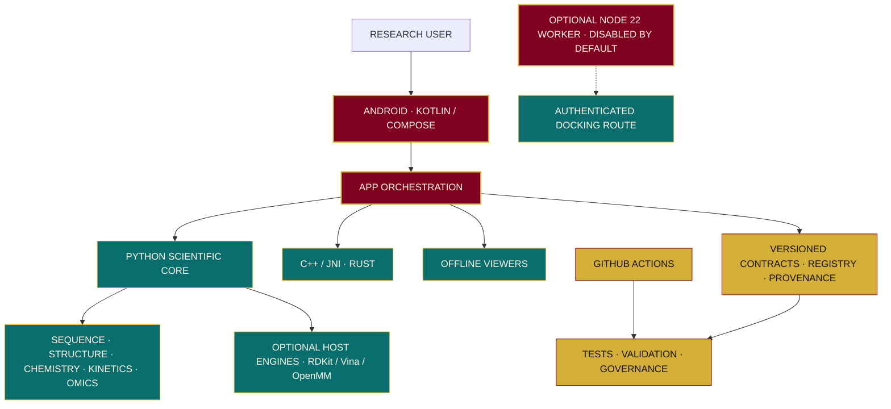

<!-- KINETICS · BY ASSAYFLUX -->
<p align="center">
  
</p>

<p align="center">
  
</p>

<p align="center">
  
</p>

<p align="center">
  <a href="https://github.com/AssayFlux/Kinetics/blob/main/LICENSE"></a>
  <a href="https://github.com/AssayFlux/Kinetics/actions/workflows/ci.yml"></a>
  <a href="https://github.com/AssayFlux/Kinetics/stargazers"></a>
  <a href="https://github.com/AssayFlux/Kinetics/forks"></a>
  <a href="https://github.com/AssayFlux/Kinetics/issues"></a>
  <a href="https://github.com/AssayFlux/Kinetics/commits/main"></a>
  
</p>

<p align="center"><strong>PRE-RELEASE &nbsp;·&nbsp; RESEARCH USE ONLY</strong></p>

<p align="center"></p>

<p align="center"></p>

## ABOUT

<p align="center">
  
</p>

**Kinetics** is an open-source scientific research workbench from **AssayFlux Scientific Systems**. It combines an Android-native, offline-first application with a Python research core and selected C++ and Rust components. Sequence, structure, chemistry, kinetics and omics foundations sit behind versioned contracts and a capability registry.

The project prioritises reproducibility, provenance, bounded inputs and explicit limitations. It is a research-engineering prototype, not a clinically validated platform.

<table>
  <tr>
    <td align="center" width="33%"><br><strong>RESEARCH</strong><br>Modular scientific workflows with clearly scoped capabilities.</td>
    <td align="center" width="33%"><br><strong>REPRODUCIBILITY</strong><br>Inputs, parameters, versions, units and provenance are preserved.</td>
    <td align="center" width="33%"><br><strong>EVIDENCE</strong><br>Implementation, tests, independent validation and device verification stay separate.</td>
  </tr>
</table>

<p align="center">
  
</p>

## SCIENTIFIC CAPABILITIES
<p align="center">
  
</p>

<table>
  <tr>
    <td align="center" width="50%"><br><strong>SEQUENCE &amp; GENOMICS</strong><br>FASTA/FASTQ, alignment, k-mer utilities, SAM/BAM/VCF foundations and variant normalisation.</td>
    <td align="center" width="50%"><br><strong>STRUCTURAL BIOLOGY</strong><br>PDB/mmCIF parsing, contacts, RMSD and bounded structure-analysis foundations.</td>
  </tr>
  <tr>
    <td align="center"><br><strong>CHEMISTRY &amp; DOCKING</strong><br>Molecular graph and SMILES/MOLBLOCK utilities; optional RDKit and AutoDock Vina adapters.</td>
    <td align="center"><br><strong>MOLECULAR DYNAMICS</strong><br>Optional OpenMM runner with explicit setup and force-field limitations.</td>
  </tr>
  <tr>
    <td align="center"><br><strong>KINETICS &amp; PK/PD</strong><br>Michaelis–Menten models and exploratory pharmacokinetic/pharmacodynamic utilities.</td>
    <td align="center"><br><strong>OMICS &amp; PGx</strong><br>Exploratory statistics, synthetic cohort utilities and research-only pharmacogenomics parsing.</td>
  </tr>
  <tr>
    <td align="center"><br><strong>ANDROID WORKBENCH</strong><br>Kotlin and Jetpack Compose foundation with offline-first constraints.</td>
    <td align="center"><br><strong>GOVERNANCE &amp; PROVENANCE</strong><br>Capability registry, JSON Schema contracts, source inventory and evidence controls.</td>
  </tr>
</table>
<p align="center">
  
</p>

## DESIGN PREVIEWS
<p align="center">
  
</p>

<table>
  <tr>
    <td align="center" width="50%">
      
      <br><sub><strong>DASHBOARD · DESIGN REFERENCE</strong></sub>
    </td>
    <td align="center" width="50%">
      
      <br><sub><strong>LOGIN · DESIGN REFERENCE</strong></sub>
    </td>
  </tr>
</table>

## STATUS AND PROGRESS
<p align="center">
  
</p>

<p align="center">
  
  
  
  <br>
  
  
  
  <br>
  
</p>

| TRACK | SCOPE | CURRENT SOFTWARE POSITION | OPEN GATE |
|:---:|---|---|---|
| **R** | Research platform | **SOFTWARE AUDIT CLOSED** | Device, independent scientific, licensing and release evidence remain. |
| **S** | Structure, sequence and discovery | **SOFTWARE SCOPE CLOSED** | Independent references, licensed resources/models and device evidence remain. |
| **I** | In-silico laboratory | **SOFTWARE AUDIT CLOSED** | Scientific benchmarks, licensing, secure-node and device evidence remain. |
| **P** | Precision-medicine research preparation | **IN PROGRESS** | Exact-head verification remains open. **P0 is BLOCKED / NOT APPROVED.** |
| **G** | Governance and assurance | **PLANNING BASELINE DRAFTED** | G0–G7 controls exist in draft; full implementation and acceptance remain gated by P verification. |
| **U** | User interface and experience | **SEQUENCED AFTER G** | Partial U0–U3 work is retained; further sequential work follows G's two-step gate assessment. |

| ENGINEERING AREA | POSITION |
|---|---|
| BUILD | GitHub Actions CI is configured. Read the live badge above for the current head. |
| TESTS | pytest and Android JVM test tasks are defined in CI. |
| COVERAGE | No verified coverage percentage is published. |
| DEPLOYMENT | No production deployment or signed public release. CI builds debug artifacts only. |

## TECHNOLOGY STACK

<p align="center">
  
</p>

<p align="center">
  
</p>

| LAYER | TECHNOLOGY |
|---|---|
| ANDROID | Kotlin, Jetpack Compose, AndroidX, Gradle, Chaquopy |
| PYTHON | Python 3.10+, setuptools, pytest, Ruff, mypy |
| NATIVE | C++17, JNI/NDK, Rust |
| OPTIONAL ENGINES | RDKit, AutoDock Vina 1.2.7, OpenMM 8.6.1 |
| VIEWER | HTML5, CSS, JavaScript, Android WebView |
| WORKER | Node.js 22+, dependency-free HTTP/TLS worker |
| CONTRACTS | JSON Schema, YAML, SPDX source inventory |

## SYSTEM ARCHITECTURE
<p align="center">
  
</p>



## QUICK START
<p align="center">
  
</p>

<details>
  <summary><strong>PREREQUISITES</strong></summary>

  - Python **3.10 or newer**, Git and a virtual environment for Python development.
  - Optional Android build: Linux x86_64 or x86_64 WSL2, JDK 17, Python 3.11.17 exactly, Rust/Cargo, Android SDK platform 36, NDK 28.2.13676358, Build Tools 36.0.0, CMake 3.22.1, `patchelf` and `patch`.
  - Optional Node worker tests: Node.js 22 or newer.
  - The Android build script downloads checksum-pinned Gradle 8.13. Termux is not a supported build host for this toolchain.
</details>

<details>
  <summary><strong>PYTHON INSTALLATION</strong></summary>

  ```bash
  python -m venv .venv
  source .venv/bin/activate
  python -m pip install --upgrade pip
  python -m pip install -r requirements-dev.txt
  python -m pip install -e .
  ```

  Windows PowerShell activation:

  ```powershell
  .venv\Scripts\Activate.ps1
  ```

  Optional engine extras:

  ```bash
  python -m pip install -e ".[docking]"
  python -m pip install -e ".[md]"
  ```
</details>

<details>
  <summary><strong>PYTHON API EXAMPLE</strong></summary>

  ```python
  from kinetics import parse_fasta

  records = parse_fasta(">demo\nACGT")
  print(records[0])
  ```

  This documents the public function shape; it was not executed as part of this README update. No verified root-level CLI entry point is claimed.
</details>

<details>
  <summary><strong>TESTS AND STATIC CHECKS</strong></summary>

  ```bash
  pytest
  ruff check scripts tests
  mypy scripts python/kinetics
  python scripts/check_registry.py
  python scripts/check_governance.py
  scripts/reproduce-all
  ```

  Optional Node worker tests:

  ```bash
  cd remote-node
  npm test
  ```

  CI also defines pinned scientific reference comparisons, chemistry smoke fixtures, source SBOM inventory, Android arm64 debug packaging, JVM tests and package-alignment checks. A passing host smoke check is not independent scientific validation or physical-device verification.
</details>

<details>
  <summary><strong>ANDROID DEBUG BUILD</strong></summary>

  On a supported Linux x86_64 / x86_64 WSL2 host:

  ```bash
  chmod +x scripts/build_android_local.sh
  scripts/build_android_local.sh
  ```

  The script builds debug APK/AAB outputs and performs package-alignment checks. It does not install the app, run an emulator or verify a physical device.
</details>

## REPOSITORY MAP
<p align="center">
  
</p>

| PATH | PURPOSE |
|---|---|
| `android/` | Kotlin app, Compose, JNI, Rust and embedded Python |
| `python/kinetics/` | Scientific Python package |
| `api/` · `schemas/` | Versioned contracts and reusable schemas |
| `capabilities/` · `domains/` · `engines/` | Capability, domain and engine metadata |
| `benchmarks/` · `validation/` · `tests/` | Reference fixtures, checks and regression tests |
| `governance/` · `paper/` · `docs/` | Assurance records, manuscript planning and documentation |
| `scripts/` · `sbom/` · `.github/workflows/` | Build, validation, inventory and CI automation |
| `remote-node/` · `web/viewers/` | Optional research worker and offline viewers |
| `data/` · `datapacks/` · `design/` | Catalogues, manifests and design inputs |
| `Assets/` | Brand artwork, animations and design references (see the asset library below) |

## RESEARCH AND SAFETY BOUNDARIES

- Kinetics is a research-engineering prototype. It is not clinically validated, is not a medical device and must not be used for diagnosis, treatment or dosing decisions.
- **P0 remains BLOCKED / NOT APPROVED.** Patient-data workflows, human-subject activity and Clinical Mode are not authorised.
- The optional Node worker is a private research boundary, binds to loopback by default and is disabled by default. Docking requires explicit enablement and bearer authentication; documented routes are `GET /health` and `POST /v1/docking`. The worker does not expose molecular-dynamics execution.
- No production service deployment, public API availability, independent docking validity, signed public release or physical-device verification is claimed.
- CI builds debug artifacts. Test definitions and green host checks do not replace independent scientific, security, licensing or device evidence.

## NEXT GATES
| TRACK | NEXT REQUIRED WORK |
|:---:|---|
| **P** | Complete exact-head software verification and the permitted research-only base. P0 requires its separate external evidence and owner gate decision. |
| **G** | Move from draft G0–G7 controls into the two-step build/audit only after P's gate is assessed; obtain independent reviews and operating evidence. |
| **U** | Resume sequential implementation only after G's two-step gate is assessed. Retain partial U0–U3 as baseline, not as accepted completion. |
| **CROSS-CUTTING** | Independent scientific benchmarks; data/model/dependency licensing and SBOM coverage; physical Android, offline, accessibility and recovery verification; real application demo. |

## CONTRIBUTION AND LICENSING
1. Read `NORTH_STAR.md`, `ROADMAP.md`, `DECISIONS.md` and `CONTRIBUTING.md`.
2. Follow `docs/ENGINEERING_INTEGRATION_STANDARD.md` and the active sequential track gate.
3. Add or update tests, schemas, provenance and licensing evidence with implementation.
4. Report checks run, checks not run, limitations and remaining gates. Never imply scientific or device validation without evidence.

**License:** Apache License 2.0. Third-party dependencies, engines, datasets, models, fonts and visual assets may have separate terms; review upstream conditions before bundling or redistribution.

## BRAND IDENTITY
<p align="center">
  
</p>

<details>
  <summary><strong>ANIMATED ORGANISATION MARK</strong></summary>

  <p align="center">
    
  </p>
</details>

## THE JOURNEYS
<p align="center">
  
</p>

<p align="center">
 
</p>

<p align="center">
  
</p>


<p align="left">
  <strong><em>LET EVERY HELIX CARRY A QUESTION ; LET EVERY ANSWER CARRY ITS EVIDENCE.</em></strong>
  <br>
  <sub>Md Safarujjaman</sub>
</p>

<p align="right">
  
</p>


<!-- ALTERNATE LINES:
1. BUILD WITH CURIOSITY; PROVE WITH EVIDENCE; LEAVE A TRACE WORTH FOLLOWING.
2. FROM A SINGLE QUESTION, WEAVE A THOUSAND REPRODUCIBLE DISCOVERIES.
3. LET PATIENCE SHAPE THE METHOD AND INTEGRITY SHAPE THE RESULT.
-->
<p align="center">
  
</p>
