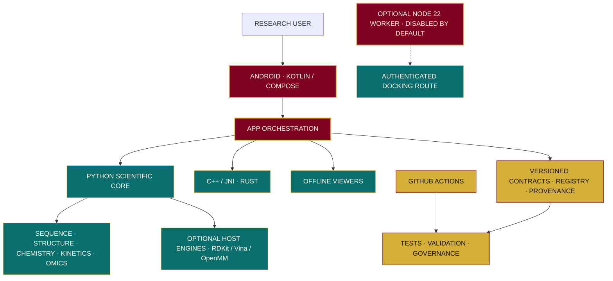

<!-- KINETICS · BY ASSAYFLUX -->

  

  

  

  

<!-- ═══════════════ REPOSITORY STATUS ═══════════════ -->

  
  
  
  
  
  
  
  

<!-- ═══════════════ CORE TECHNOLOGY ═══════════════ -->

  
  
  
  
  
  
  

<!-- ═══════════════ ANDROID & BUILD ECOSYSTEM ═══════════════ -->

  
  
  
  
  
  

<!-- ═══════════════ SCIENTIFIC ECOSYSTEM ═══════════════ -->

  
  
  
  
  
  
  

<!-- ═══════════════ QUALITY & REPRODUCIBILITY ═══════════════ -->

  
  
  
  
  
  
  
  

<!-- ═══════════════ PROJECT IDENTITY ═══════════════ -->

  
  
  
  
  

## ABOUT
**Kinetics** is an open-source scientific research workbench from **AssayFlux Scientific Systems**. It combines an Android-native, offline-first application with a Python research core and selected C++ and Rust components. Sequence, structure, chemistry, kinetics and omics foundations sit behind versioned contracts and a capability registry.

The project prioritises reproducibility, provenance, bounded inputs and explicit limitations. It is a research-engineering prototype, not a clinically validated platform.

<table>
  <tr>
    <td align="center" width="33%"> <strong>RESEARCH</strong> Modular scientific workflows with clearly scoped capabilities.</td>
    <td align="center" width="33%"> <strong>REPRODUCIBILITY</strong> Inputs, parameters, versions, units and provenance are preserved.</td>
    <td align="center" width="33%"> <strong>EVIDENCE</strong> Implementation, tests, independent validation and device verification stay separate.</td>
  </tr>
</table>

## SCIENTIFIC CAPABILITIES
<table>
  <tr>
    <td align="center" width="50%"> <strong>SEQUENCE &amp; GENOMICS</strong> FASTA/FASTQ, alignment, k-mer utilities, SAM/BAM/VCF foundations and variant normalisation.</td>
    <td align="center" width="50%"> <strong>STRUCTURAL BIOLOGY</strong> PDB/mmCIF parsing, contacts, RMSD and bounded structure-analysis foundations.</td>
  </tr>
  <tr>
    <td align="center"> <strong>CHEMISTRY &amp; DOCKING</strong> Molecular graph and SMILES/MOLBLOCK utilities; optional RDKit and AutoDock Vina adapters.</td>
    <td align="center"> <strong>MOLECULAR DYNAMICS</strong> Optional OpenMM runner with explicit setup and force-field limitations.</td>
  </tr>
  <tr>
    <td align="center"> <strong>KINETICS &amp; PK/PD</strong> Michaelis–Menten models and exploratory pharmacokinetic/pharmacodynamic utilities.</td>
    <td align="center"> <strong>OMICS &amp; PGx</strong> Exploratory statistics, synthetic cohort utilities and research-only pharmacogenomics parsing.</td>
  </tr>
  <tr>
    <td align="center"> <strong>ANDROID WORKBENCH</strong> Kotlin and Jetpack Compose foundation with offline-first constraints.</td>
    <td align="center"> <strong>GOVERNANCE &amp; PROVENANCE</strong> Capability registry, JSON Schema contracts, source inventory and evidence controls.</td>
  </tr>
</table>

  

## DESIGN PREVIEWS
<table>
  <tr>
    <td align="center" width="50%">
      
       <strong>DASHBOARD · DESIGN REFERENCE</strong>
    </td>
    <td align="center" width="50%">
      
       <strong>LOGIN · DESIGN REFERENCE</strong>
    </td>
  </tr>
</table>

## STATUS AND PROGRESS
| TRACK | SCOPE | CURRENT SOFTWARE POSITION | OPEN GATE |
|:---:|---|---|---|
| **R** | Research platform | **SOFTWARE AUDIT CLOSED** | Device, independent scientific, licensing and release evidence remain. |
| **S** | Structure, sequence and discovery | **SOFTWARE SCOPE CLOSED** | Independent references, licensed resources/models and device evidence remain. |
| **I** | In-silico laboratory | **SOFTWARE AUDIT CLOSED** | Scientific benchmarks, licensing, secure-node and device evidence remain. |
| **P** | Precision-medicine research preparation | **IN PROGRESS** | Exact-head verification remains open. **P0 is BLOCKED / NOT APPROVED.** |
| **G** | Governance and assurance | **PLANNING BASELINE DRAFTED** | G0–G7 controls exist in draft; full implementation and acceptance remain gated by P verification. |
| **U** | User interface and experience | **SEQUENCED AFTER G** | Partial U0–U3 work is retained; further sequential work follows G's two-step gate assessment. |

| ENGINEERING AREA | POSITION |
|---|---|
| BUILD | GitHub Actions CI is configured. Read the live badge above for the current head. |
| TESTS | pytest and Android JVM test tasks are defined in CI. |
| COVERAGE | No verified coverage percentage is published. |
| DEPLOYMENT | No production deployment or signed public release. CI builds debug artifacts only. |

## TECHNOLOGY STACK

  

| LAYER | TECHNOLOGY |
|---|---|
| ANDROID | Kotlin, Jetpack Compose, AndroidX, Gradle, Chaquopy |
| PYTHON | Python 3.10+, setuptools, pytest, Ruff, mypy |
| NATIVE | C++17, JNI/NDK, Rust |
| OPTIONAL ENGINES | RDKit, AutoDock Vina 1.2.7, OpenMM 8.6.1 |
| VIEWER | HTML5, CSS, JavaScript, Android WebView |
| WORKER | Node.js 22+, dependency-free HTTP/TLS worker |
| CONTRACTS | JSON Schema, YAML, SPDX source inventory |

## SYSTEM ARCHITECTURE

## NEXT GATES
| TRACK | NEXT REQUIRED WORK |
|:---:|---|
| **P** | Complete exact-head software verification and the permitted research-only base. P0 requires its separate external evidence and owner gate decision. |
| **G** | Move from draft G0–G7 controls into the two-step build/audit only after P's gate is assessed; obtain independent reviews and operating evidence. |
| **U** | Resume sequential implementation only after G's two-step gate is assessed. Retain partial U0–U3 as baseline, not as accepted completion. |
| **CROSS-CUTTING** | Independent scientific benchmarks; data/model/dependency licensing and SBOM coverage; physical Android, offline, accessibility and recovery verification; real application demo. |

## CONTRIBUTION AND LICENSING
1. Read `NORTH_STAR.md`, `ROADMAP.md`, `DECISIONS.md` and `CONTRIBUTING.md`.
2. Follow `docs/ENGINEERING_INTEGRATION_STANDARD.md` and the active sequential track gate.
3. Add or update tests, schemas, provenance and licensing evidence with implementation.
4. Report checks run, checks not run, limitations and remaining gates. Never imply scientific or device validation without evidence.

**License:** Apache License 2.0. Third-party dependencies, engines, datasets, models, fonts and visual assets may have separate terms; review upstream conditions before bundling or redistribution.

## BRAND IDENTITY

  

## THE JOURNEYS

  

 

  

  

  

  

  

  

  

  

  

  

  

  

## CULTURAL REPRESENTATIONS

  

  

  

  

  

  

  

  

  

  

