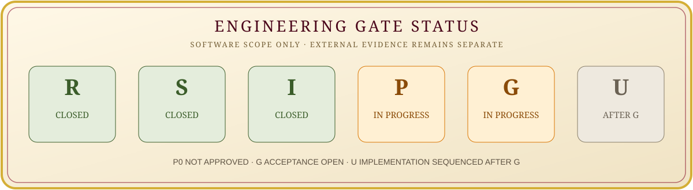
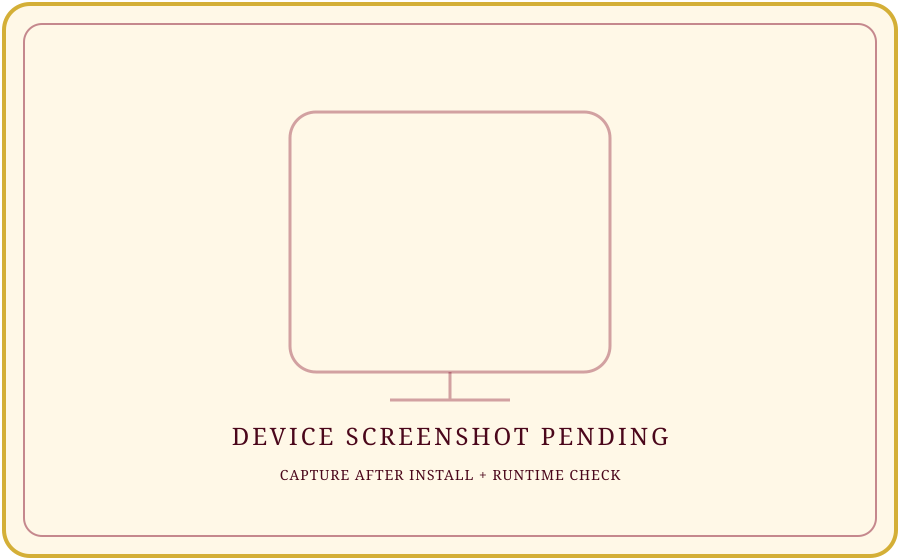
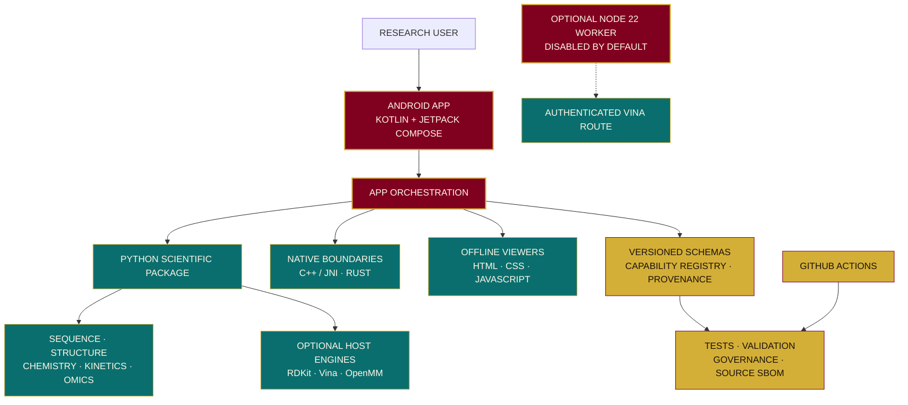
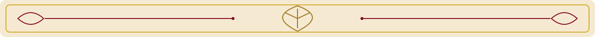

  

  

  

  
  &nbsp;&nbsp;
  
  &nbsp;&nbsp;
  
   
  <strong>ASSAYFLUX · ORIGINAL VECTOR MARK · KINETICS</strong>

<h1 align="center">KINETICS</h1>

  

  
  
  
  
  
  
  
  
  
  

<strong>PRE-RELEASE · RESEARCH USE ONLY · NOT CLINICALLY VALIDATED</strong>

  

  

## 01 · PROJECT IDENTITY

**KINETICS** is an open-source, modular scientific research workbench from **ASSAYFLUX SCIENTIFIC SYSTEMS**. Its engineering direction is an Android-native, offline-first experience supported by a scientific Python core, selected C++ and Rust components, versioned contracts, a capability registry and reproducibility tooling.

The repository brings together foundations for sequence and genomics, structural biology, chemistry and docking, molecular dynamics, kinetics and PK/PD, and omics/pharmacogenomics. Kinetics prioritises reproducibility, provenance, bounded inputs and explicit limitations. It remains an evolving research-engineering prototype, not a clinically validated platform.

The visual identity uses a restrained Indian-heritage palette: royal maroon, antique gold, warm ivory, sandstone, indigo, peacock teal and charcoal. Original local SVG ornaments provide the toran, mandala, jali and chapter treatments.

### WHY THIS PROJECT?

<table>
  <tr>
    <td align="center" width="33%">
      <h3>🧬 RESEARCH</h3>
      Explore modular scientific workflows with clearly scoped capabilities.
    </td>
    <td align="center" width="33%">
      <h3>🔬 REPRODUCIBILITY</h3>
      Preserve inputs, parameters, versions, units and provenance.
    </td>
    <td align="center" width="33%">
      <h3>🛡️ EVIDENCE</h3>
      Separate implementation, automated tests, independent validation and device verification.
    </td>
  </tr>
</table>

  

## 02 · SCIENTIFIC PHILOSOPHY

  

**A RESEARCH WORKBENCH BUILT TO MAKE METHODS, INPUTS, PARAMETERS AND LIMITATIONS INSPECTABLE.**

  

## 03 · ENGINEERING STATUS

| STATUS AREA | VERIFIED POSITION |
|---|---|
| BUILD | GitHub Actions CI workflow is configured. Current-head result must be read from the live badge; a green historical run is not proof for a newer commit. |
| TESTS | pytest suite and Android JVM test task are defined in CI. Tests have not been executed as part of this remote documentation update. |
| COVERAGE | No verified coverage percentage is published. |
| DEPLOYMENT | No production deployment or signed public release is claimed. CI builds debug artifacts. |
| MAINTENANCE | Active repository development is visible in recent commits. |
| CONTRIBUTIONS | Follow CONTRIBUTING.md and the owner-controlled integration and track gates. |

  

  

| TRACK | SCOPE | ENGINEERING STATUS | EVIDENCE / REMAINING GATE |
|---|---|---|---|
| R | Research platform | **SOFTWARE AUDIT CLOSED** | Device, independent scientific, licensing and release evidence remain carry-forward. |
| S | Structure, sequence and discovery | **SOFTWARE SCOPE CLOSED** | Independent references, licensed resources/models and device evidence remain open. |
| I | In-silico laboratory | **SOFTWARE AUDIT CLOSED** | Scientific benchmarks, licensing, secure node and device verification remain open. |
| P | Precision-medicine research preparation | **IN PROGRESS** | P0 remains BLOCKED / NOT APPROVED; independent, licensing, operational and reviewer gates remain. |
| G | Governance and assurance | **IN PROGRESS** | G0–G7 engineering controls are being built and audited; formal acceptance and independent reviews remain open. |
| U | User interface and experience | **SEQUENCED AFTER G** | Partial U0–U3 implementation is retained as baseline; further work waits for G's gate assessment. |

**PERCENTAGE POLICY:** R, S and I are described as closed only for their documented software/audit scope. P and G are not assigned invented completion percentages. U's acceptance gate is not closed; this does not mean its existing partial source is absent. No overall scientific, clinical, regulatory or release-compliance percentage is claimed.

**AUTHORITY:** DECISIONS.md D-023 and ROADMAP.md. Current order: **R → S → I → P → G → U**.

  

## 04 · VISUAL GALLERY

  

**NO VERIFIED APPLICATION DEMO GIF IS CURRENTLY PRESENT AT assets/demo.gif.** The existing standalone Canvas animation is [kinetics_dna_loader.html](assets/brand/kinetics_dna_loader.html). The historical README references a Python generator at assets/brand/DNA.py, but that path is not present on the inspected main branch; the generator is therefore not advertised as a current feature.

  
   
  <strong>BRAND ANIMATION PREVIEW · NOT A RUNNING APP SCREENSHOT</strong>

<table>
  <tr>
    <td align="center" width="50%">
      
       <strong>DASHBOARD DESIGN REFERENCE</strong>
    </td>
    <td align="center" width="50%">
      
       <strong>LOGIN DESIGN REFERENCE</strong>
    </td>
  </tr>
  <tr>
    <td align="center" colspan="2">
      
       <strong>REAL DEVICE SCREENSHOT — PENDING</strong>
    </td>
  </tr>
</table>

  

## 05 · SCIENTIFIC CAPABILITIES

<table>
  <tr>
    <td width="50%">
      <strong>🧬 SEQUENCE AND GENOMICS</strong> 
      FASTA/FASTQ parsing, sequence statistics, alignment, k-mer utilities, SAM/BAM/VCF foundations and variant normalisation.
    </td>
    <td width="50%">
      <strong>🧫 STRUCTURAL BIOLOGY</strong> 
      PDB/mmCIF parsing, contacts, RMSD and bounded structure-analysis foundations with an offline viewer.
    </td>
  </tr>
  <tr>
    <td>
      <strong>⚗️ CHEMISTRY AND DOCKING</strong> 
      Molecular graph and SMILES/MOLBLOCK utilities, optional RDKit adapter and optional AutoDock Vina runner.
    </td>
    <td>
      <strong>🧪 MOLECULAR DYNAMICS</strong> 
      Optional OpenMM runner with explicit setup and force-field limitations.
    </td>
  </tr>
  <tr>
    <td>
      <strong>📈 KINETICS AND PK/PD</strong> 
      Michaelis–Menten models and exploratory pharmacokinetic/pharmacodynamic reference utilities.
    </td>
    <td>
      <strong>🧮 OMICS AND PGX FOUNDATIONS</strong> 
      Exploratory omics statistics, synthetic cohort utilities and research-only pharmacogenomics parsing foundations.
    </td>
  </tr>
  <tr>
    <td>
      <strong>📱 ANDROID WORKBENCH</strong> 
      Kotlin and Jetpack Compose application foundation with local workflows and offline-first constraints.
    </td>
    <td>
      <strong>🔐 GOVERNANCE AND PROVENANCE</strong> 
      Capability registry, JSON Schema contracts, source inventory, validation records and governance controls.
    </td>
  </tr>
</table>

**FEATURES ABOVE DESCRIBE IMPLEMENTATION FOUND IN SOURCE. THEY DO NOT MEAN EVERY ENGINE IS ENABLED, EVERY WORKFLOW IS COMPLETE, OR EVERY SCIENTIFIC METHOD HAS INDEPENDENT VALIDATION.**

  

## 06 · TECHNOLOGY STACK

### REPOSITORY STATISTICS

  
  
  

  
<strong>REPRODUCIBLE INVENTORY NOTES</strong>

  - The latest documented recursive repository audit recorded **356 tracked files** across **55 non-root directories** at revision <code>dafc3cad56bc6b9b9b49cc30f9e5f65bbd655c47</code>. This is a dated baseline, not a fresh count of the current head.
  - Python is the primary scientific implementation language. Kotlin, C++ and Rust support the Android/native stack; JavaScript, HTML and CSS support the offline viewer; Bash and YAML support automation.
  - Exact source-language line percentages are intentionally omitted. A reproducible source-only LOC report has not been produced for the current revision.
  - The package distribution version in <code>pyproject.toml</code> and <code>CITATION.cff</code> is <code>0.0.0</code>; <code>python/kinetics/__init__.py</code> currently exposes <code>0.1.0</code>. Resolve this version mismatch before a release.
  - Commit/contributor counts are left to the live GitHub statistics rather than hard-coded from an incomplete remote log.

<strong>FRONTEND AND ANDROID</strong>

<strong>BACKEND AND SCIENTIFIC CORE</strong>

<strong>DATABASE AND CONTRACTS</strong>

<strong>DEVOPS AND BUILD</strong>

<strong>QUALITY AND TOOLS</strong>

| LAYER | REPOSITORY EVIDENCE |
|---|---|
| ANDROID | Kotlin, Jetpack Compose, AndroidX, Gradle, Chaquopy |
| PYTHON | Python 3.10+, setuptools, pytest, Ruff, mypy |
| NATIVE | C++17, JNI/NDK and Rust toolchain |
| OPTIONAL SCIENTIFIC ENGINES | RDKit, AutoDock Vina 1.2.7 and OpenMM 8.6.1 adapters/extras |
| VIEWER | HTML5, CSS, JavaScript and Android WebView |
| NODE WORKER | Node.js 22+, dependency-free HTTP/TLS worker |
| CONTRACTS | JSON Schema, YAML and SPDX source inventory |

  

## 07 · ARCHITECTURE

The following is a repository-level component map. It does not imply that every optional engine or remote path is enabled in the Android application.

  

## 08 · QUICK START

  
<strong>PREREQUISITES</strong>

  - Python **3.10 or newer** for the declared package.
  - Git and a virtual environment for Python development.
  - Optional Android build: Linux x86_64 or x86_64 WSL2, JDK 17, Python 3.11.17 exactly, Rust/Cargo, Android SDK platform 36, NDK 28.2.13676358, Build Tools 36.0.0, CMake 3.22.1, <code>patchelf</code> and <code>patch</code>.
  - Optional Node worker tests: Node.js 22 or newer.
  - The Android build script downloads checksum-pinned Gradle 8.13. Termux on Android is not a supported build host for this toolchain.

  
<strong>INSTALLATION — PYTHON DEVELOPMENT</strong>

  <pre><code>python -m venv .venv
source .venv/bin/activate
python -m pip install --upgrade pip
python -m pip install -r requirements-dev.txt
python -m pip install -e .</code></pre>

  Windows PowerShell activation:

  <pre><code>.venv\Scripts\Activate.ps1</code></pre>

  Optional engine extras are declared in <code>pyproject.toml</code>:

  <pre><code>python -m pip install -e ".[docking]"
python -m pip install -e ".[md]"</code></pre>

  
<strong>CONFIGURATION</strong>

  There is no root <code>.env.example</code> and no project-wide environment file is required for the Python development workflow.

  The optional research worker documents these environment variables in <code>remote-node/README.md</code>:

  - <code>KINETICS_NODE_ALLOW_DOCKING</code>
  - <code>KINETICS_NODE_AUTH_TOKEN</code>
  - <code>KINETICS_NODE_HOST</code>
  - <code>KINETICS_NODE_TLS_CERT</code>
  - <code>KINETICS_NODE_TLS_KEY</code>

  The worker is disabled by default. Keep secrets out of source control, shell history and issue attachments.

  
<strong>USAGE — PYTHON API EXAMPLE</strong>

  The package exports sequence helpers from <code>kinetics</code>. This source-backed example parses an in-memory FASTA string:

  <pre><code>from kinetics import parse_fasta

records = parse_fasta("&gt;demo\nACGT")
print(records[0])</code></pre>

  This example documents the public function shape; it was not executed as part of this remote README update. There is no verified root-level command-line application entry point.

  
<strong>TESTING AND STATIC CHECKS</strong>

  Commands used by the checked-in CI workflow:

  <pre><code>pytest
ruff check scripts tests
mypy scripts python/kinetics
python scripts/check_registry.py
python scripts/check_governance.py
scripts/reproduce-all</code></pre>

  Optional Node worker tests:

  <pre><code>cd remote-node
npm test</code></pre>

  CI also defines pinned scientific reference comparisons, chemistry smoke fixtures, source SBOM inventory, Android arm64 debug packaging, JVM tests and package-alignment checks. A passing host smoke check is not independent scientific validation or physical-device verification.

  
<strong>ANDROID DEBUG BUILD</strong>

  On a supported Linux x86_64 / x86_64 WSL2 host with the prerequisites above:

  <pre><code>chmod +x scripts/build_android_local.sh
scripts/build_android_local.sh</code></pre>

  The script builds debug APK/AAB outputs and performs package-alignment checks. It explicitly does not install the application, run an emulator or verify a physical device.

  

## 09 · REPOSITORY STRUCTURE

<pre><code>Kinetics/
├── android/                 # Kotlin app, Compose, JNI, Rust and embedded Python
│   └── native-rust/          # Android Rust crate and native bridge
├── api/                     # Versioned API, message and evidence contracts
├── assets/                  # Canonical brand artwork and design references
│   ├── brand/               # Logos, signature, animation and brand assets
│   ├── cards/               # Original royal heritage README cards
│   ├── design-previews/     # Owner-supplied UI design references
│   └── ornaments/           # Original toran, mandala, jali and dividers
├── benchmarks/              # Benchmark protocols and fixtures
├── capabilities/            # Capability registry and status metadata
├── cpp/                     # Reserved C++ workspace; Android JNI code lives under android/
├── data/                    # Source catalogues and metadata
├── datapacks/               # Data-pack manifests and planned payloads
├── design/                  # Design tokens and generated design inputs
├── docs/                    # Architecture, audits, track plans and UI specs
├── domains/                 # Scientific domain metadata
├── engines/                 # Engine metadata and integration points
├── governance/              # Governance and assurance registers
├── paper/                   # Manuscript planning and claim-evidence ledger
├── python/kinetics/         # Scientific Python package
├── remote-node/             # Optional, disabled-by-default Node worker
├── rust/                    # Reserved standalone Rust workspace; Android Rust crate under android/native-rust/
├── schemas/                 # Reusable domain and data schemas
├── scripts/                 # Build, generation, validation and inventory
├── sbom/                    # Software bill-of-materials materials
├── tests/                   # Python regression and contract tests
├── validation/              # Pinned reference and engine smoke checks
├── web/viewers/             # Offline HTML/CSS/JavaScript viewers
├── .github/workflows/       # GitHub Actions CI
├── CHANGELOG.md              # User-visible change history
├── CITATION.cff              # Citation metadata
├── KINETICS_UI_SPEC.md       # Owner-directed UI specification
├── PRIVACY.md                # Privacy and data-handling policy
├── SECURITY.md               # Security policy and reporting
├── SESSION_LOG.md            # Append-only engineering history
├── pyproject.toml           # Python package metadata and tool configuration
├── requirements-dev.txt     # Development dependencies
├── ROADMAP.md               # Canonical track plan
├── DECISIONS.md              # Owner decisions and supersession history
├── NORTH_STAR.md             # Mission, boundaries and direction
└── LICENSE                   # Apache License 2.0</code></pre>

**THIS IS A DOCUMENTATION-LEVEL MAP OF THE MAIN AREAS, NOT A CLAIM THAT EVERY DIRECTORY CONTAINS A COMPLETE PRODUCT MODULE.** See [docs/README.md](docs/README.md) for the canonical documentation index.

  

## 10 · API AND RESEARCH BOUNDARIES

- The Python library is packaged from <code>python/</code> and imported as <code>kinetics</code>.
- Versioned contracts live in <code>api/</code> and reusable schemas in <code>schemas/</code>.
- The optional Node worker is a private research compute boundary, not a public API. Its documented routes are <code>GET /health</code> and bearer-authenticated <code>POST /v1/docking</code>.
- The worker binds to loopback by default; docking is disabled unless explicitly enabled. The service does not expose molecular-dynamics execution.
- No production service deployment, public API availability or independent docking validity is claimed.

  

  

## 11 · ROADMAP

The current sequential track order is **R → S → I → P → G → U** under D-023.

- [x] **R — RESEARCH PLATFORM SOFTWARE AUDIT RECORDED CLOSED.**
- [x] **S — STRUCTURE, SEQUENCE AND DISCOVERY SOFTWARE SCOPE RECORDED CLOSED.**
- [x] **I — IN-SILICO LABORATORY SOFTWARE AUDIT RECORDED CLOSED.**
- [ ] **P — COMPLETE THE PERMITTED RESEARCH-ONLY ENGINEERING BASE; P0 AND EXTERNAL ACCEPTANCE GATES REMAIN OPEN.**
- [ ] **G — COMPLETE G0–G7 ENGINEERING, EXACT-HEAD AUDIT, INDEPENDENT REVIEWS AND OPERATING EXERCISES.**
- [ ] **U — RESUME SEQUENTIAL UI IMPLEMENTATION AFTER G'S GATE IS ASSESSED; VERIFY ON TARGET DEVICES.**
- [ ] **PUBLISH REPRODUCIBLE CAPABILITY-LEVEL SCIENTIFIC REFERENCE AND BENCHMARK EVIDENCE.**
- [ ] **COMPLETE DATA, MODEL AND DEPENDENCY LICENSING DECISIONS AND RELEASE-GRADE SBOM COVERAGE.**
- [ ] **COMPLETE PHYSICAL ANDROID DEVICE, OFFLINE-MODE, ACCESSIBILITY AND RECOVERY VERIFICATION.**
- [ ] **CAPTURE A REAL APPLICATION DEMO AFTER VERIFIED INSTALLATION AND RUNTIME EXERCISES.**

P0 remains **BLOCKED / NOT APPROVED**. No roadmap item authorizes patient-data workflows, clinical interpretation, diagnosis, treatment or dosing recommendations.

  

## 12 · CONTRIBUTIONS AND LICENSING

### CONTRIBUTING

1. Read <code>NORTH_STAR.md</code>, <code>ROADMAP.md</code> and <code>DECISIONS.md</code>.
2. Read <code>CONTRIBUTING.md</code> and <code>docs/ENGINEERING_INTEGRATION_STANDARD.md</code>.
3. Work only on an active, permitted item and respect the sequential track gates.
4. Add or update tests, schemas, provenance and licensing evidence alongside implementation.
5. Report checks run, checks not run, limitations and the next step. Never claim scientific or device validation without evidence.

### LICENSE

The repository includes the **Apache License 2.0**. Third-party dependencies, engines, datasets, models, fonts and visual assets may have separate licenses and redistribution conditions. Review their upstream terms before bundling or redistributing them.

### CONTACT

- **GITHUB:** [AssayFlux / Kinetics](https://github.com/AssayFlux/Kinetics)
- **LINKEDIN:** OWNER PROFILE LINK — PLACEHOLDER
- **EMAIL:** PUBLIC PROJECT EMAIL — PLACEHOLDER
- **PORTFOLIO:** OWNER WEBSITE — PLACEHOLDER

Only the repository URL is currently verified. No personal email, LinkedIn or portfolio URL has been invented.

  

## 13 · ACKNOWLEDGEMENTS

  🪷 **WITH GRATITUDE TO THE OPEN-SOURCE SCIENTIFIC, BIOINFORMATICS, ANDROID AND DEVELOPER-TOOL COMMUNITIES WHO MAKE REPRODUCIBLE RESEARCH POSSIBLE.** 🪔

  

## 14 · FINAL ROYAL SEAL

  

  

  <strong>MADE WITH ❤️ IN INDIA BY ASSAYFLUX</strong> 
  <em>LET EVERY HELIX CARRY A QUESTION, AND EVERY ANSWER ITS EVIDENCE.</em> 
  ASSAYFLUX SCIENTIFIC SYSTEMS · KINETICS

---

<strong>HUMAN CIVILISATION · SEVEN CHAPTERS · SHARED HERITAGE</strong>

  

