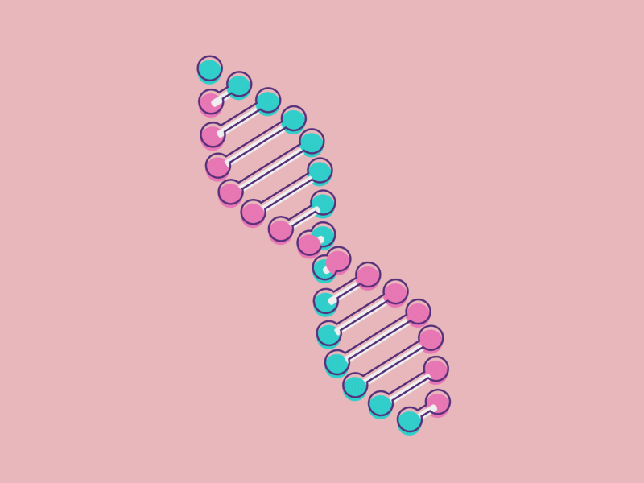

<!--
Kinetics README
Language percentages are intentionally not fabricated; see the source-statistics TODO below.
-->

<p align="center">
  
</p>

<p align="center">
  
  &nbsp;&nbsp;
  
  &nbsp;&nbsp;
  
</p>

<p align="center">
  <strong>My DNA animation design</strong>
  <br>
  <a href="https://htmlpreview.github.io/?https://github.com/AssayFlux/Kinetics/blob/main/assets/brand/kinetics_dna_loader.html">▶ Open the animated DNA loader</a>
  ·
  <a href="assets/brand/kinetics_dna_loader.html">View HTML source</a>
  <br>
  <sub>Original animation design by the project owner · HTML5 Canvas · no GIF required</sub>
</p>

<h1 align="center">Kinetics</h1>
<p align="center">
  <strong>Explore biology. Reproduce the work. Keep the evidence.</strong>
</p>
<p align="center">
  
</p>

<p align="center">
  <a href="https://github.com/AssayFlux/Kinetics/blob/main/LICENSE"></a>
  
  <a href="https://github.com/AssayFlux/Kinetics/stargazers"></a>
  <a href="https://github.com/AssayFlux/Kinetics/forks"></a>
  <a href="https://github.com/AssayFlux/Kinetics/issues"></a>
  <a href="https://github.com/AssayFlux/Kinetics/commits/main"></a>
  <a href="https://github.com/AssayFlux/Kinetics/actions/workflows/ci.yml"></a>
</p>

<p align="center">
  <strong>Pre-release · Research use only · Not clinically validated</strong>
</p>

---

## Visual preview

<p align="center">
  <strong>DNA animation — designed by the project owner</strong>
  <br>
  <a href="https://htmlpreview.github.io/?https://github.com/AssayFlux/Kinetics/blob/main/assets/brand/kinetics_dna_loader.html">▶ Play the HTML animation</a>
  ·
  <a href="assets/brand/kinetics_dna_loader.html">Inspect the standalone HTML</a>
  <br>
  <sub>The animation runs from HTML5 Canvas; it is intentionally not exported as a GIF.</sub>
</p>

<p align="center">
  <strong>App dashboard and login — UI design references</strong>
</p>

<table>
  <tr>
    <td align="center" width="50%">
      
      <sub>Dashboard concept</sub>
    </td>
    <td align="center" width="50%">
      
      <sub>Login concept</sub>
    </td>
  </tr>
</table>

<p align="center"><em>These are existing design-preview assets, not verified captures of a running or production-ready app. A real in-app walkthrough can be added after device capture.</em></p>

## About Kinetics

Kinetics is an open-source, modular scientific research workbench designed around an **Android-native, offline-first experience**. Its repository combines scientific Python modules, a Kotlin/Jetpack Compose Android application, selected Rust and C++ native components, versioned data contracts, and reproducibility and governance tooling.

The codebase explores workflows across genomics, sequence analysis, structural biology, computational chemistry, enzyme kinetics, omics and research-oriented pharmacology utilities. A capability registry connects tools with engines, data packs and scientific domains. Results are designed to retain input hashes, parameters, versions, units and other provenance needed to inspect or reproduce an analysis.

Kinetics is an evolving engineering prototype. Source code, automated tests, independent scientific validation, physical-device verification and formal acceptance are tracked as distinct evidence states.

The standalone DNA animation is implemented in `assets/brand/kinetics_dna_loader.html` using HTML5 Canvas. The earlier GIF export has been removed; use the HTML file as the live animation source.

### Why this project?

- **Research workflows that can travel:** an Android-first architecture with local/offline constraints and a separately gated optional compute worker.
- **Evidence, not just output:** versioned schemas, explicit units, provenance metadata, reference comparisons and conservative failure boundaries.
- **A visible path to trust:** capability and governance registers distinguish implementation from validation, licensing, device support and external approval.

> [!IMPORTANT]
> **Research-only boundary:** Kinetics is not a validated medical device or clinical decision-support system. P0 remains **BLOCKED / NOT APPROVED**. Patient/clinical data, identifiable human-subject activity, individual clinical interpretation, diagnosis, treatment or dosing recommendations, and Clinical Mode are not authorized. Do not use outputs for patient care.

## What exists in the codebase

| 🧬 Biology & sequence | 🧪 Chemistry & quantitative research |
|---|---|
| FASTA/FASTQ parsing, sequence statistics, alignment and k-mer utilities | Molecular graph and SMILES/MolBlock analysis through an optional RDKit adapter |
| SAM/BAM/VCF parsing and small-variant normalization utilities | AutoDock Vina docking runner for caller-prepared PDBQT inputs |
| ORF, GFF3, genome QC and annotation helpers | OpenMM molecular-dynamics runner with explicit setup limitations |
| HMMER/BLASTP/Augustus/Prodigal adapters and evidence-oriented workflows | Michaelis–Menten models, fitting and exploratory transforms |
| Phylogenetic distance, neighbour joining, UPGMA and Newick utilities | PK/PD reference models, omics statistics and synthetic cohort utilities |
| PGx/PharmVar parsing and synthetic/reference-bound genotype QC foundations | ADMET evaluation metrics and applicability-domain utilities; no bundled predictive model |

| 🧩 Platform & integration | 🔎 Quality & governance |
|---|---|
| Kotlin + Jetpack Compose Android app foundation | pytest suite and GitHub Actions validation workflow |
| Python package under `python/kinetics/` | Ruff, mypy and pre-commit configuration |
| Rust Android arm64 library and C++/JNI build integration | JSON Schema contracts and capability registry checks |
| Offline structure viewer in HTML/CSS/JavaScript | Scientific reference-comparison and engine smoke workflows |
| Optional Node 22 research docking worker, disabled by default | Source dependency inventory, threat model, privacy and governance registers |

Feature names describe code present in the repository, not a promise that every workflow is complete, independently validated or supported on every device. See the capability registry, research-readiness audit and documentation index.

## Engineering progress

The percentages below are the repository's **documented track engineering-gate status**, not a percentage of scientific validity, clinical readiness, release readiness or regulatory compliance.

<table>
  <thead>
    <tr><th align="left">Track</th><th align="left">Scope</th><th align="left">Engineering gate</th><th align="left">Evidence still open</th></tr>
  </thead>
  <tbody>
    <tr>
      <td><strong>R</strong></td><td>Research platform, Android foundation, scientific primitives</td>
      <td></td>
      <td>Physical-device, independent scientific, licensing and release evidence</td>
    </tr>
    <tr>
      <td><strong>S</strong></td><td>Structure, sequence discovery, annotation and protein intelligence</td>
      <td></td>
      <td>Independent references, approved resources/models and device evidence</td>
    </tr>
    <tr>
      <td><strong>I</strong></td><td>In-silico chemistry, docking, MD, ADMET and PK/PD utilities</td>
      <td></td>
      <td>Real scientific benchmarks, data/model licences, secure node and device tests</td>
    </tr>
    <tr>
      <td><strong>P</strong></td><td>PGx-first precision-medicine research preparation</td>
      <td></td>
      <td>P0 external determinations, independent evidence and formal owner gate; P0 is not approved</td>
    </tr>
    <tr>
      <td><strong>G</strong></td><td>Security, supply chain, quality, privacy and scientific/publication integrity</td>
      <td></td>
      <td>Exact-head audit, independent reviews, role appointments and operating exercises</td>
    </tr>
    <tr>
      <td><strong>U</strong></td><td>Design system, Android UX and research workflows</td>
      <td></td>
      <td>Further sequential implementation follows G; prior U0–U3 work remains partial baseline</td>
    </tr>
  </tbody>
</table>

<sub>Estimate method: values reproduce the track-level engineering-gate statements in the current project status documentation and D-023. “100%” means that track's documented software implementation/audit gate was closed; “0% accepted” means the formal track exit gate has not been accepted, not that no source exists. P is deliberately not assigned a made-up percentage.</sub>

## Current project status

<p align="center">
  <a href="https://github.com/AssayFlux/Kinetics/actions/workflows/ci.yml"></a>
  <a href="https://github.com/AssayFlux/Kinetics/tree/main/tests"></a>
  
  
</p>

- **Build / CI:** GitHub Actions is configured. The latest run inspected during this README audit passed on commit `50366e8`; use the live workflow badge for current status.
- **Tests:** 62 Python test modules are present. The CI workflow also defines Android JVM tests, scientific reference comparisons, native-engine smoke checks and Node worker security tests.
- **Coverage:** no verified coverage percentage is published; none is claimed here.
- **Deployment:** no production deployment is claimed. Android CI artifacts are debug APK/AAB outputs.
- **Maintenance:** the repository is actively changing; see recent commits.
- **Contributions:** read CONTRIBUTING.md and the active roadmap before proposing work. The repository does not declare an unconditional PR acceptance policy.

## Technology

<p align="center">
  <a href="https://skillicons.dev/icons?i=python,kotlin,cpp,rust,js,html,css,bash,cmake,gradle,githubactions"></a>
</p>

| Layer | Technologies in repository |
|---|---|
| Android | Kotlin, Jetpack Compose, AndroidX, Gradle, Chaquopy |
| Scientific core | Python 3.10+, NumPy; optional Biopython, RDKit, AutoDock Vina and OpenMM |
| Native | C++17, JNI/NDK, Rust 1.88 toolchain |
| Visualisation | HTML5, CSS, JavaScript, Android WebView |
| Contracts & metadata | JSON Schema, YAML, SPDX source inventory |
| Quality | pytest, Ruff, mypy, pre-commit, GitHub Actions |
| Optional worker | Node.js 22, dependency-free HTTP/TLS service |

The root package metadata is in pyproject.toml. Optional extras are declared there; validation-only pinned dependency sets live under `validation/`. Third-party engines, models, datasets, fonts and artwork may carry separate terms.

<details>
  <summary><strong>Source-language mix and repository statistics</strong></summary>

  - A dated repository audit records **356 tracked files** across **55 non-root directories** at its audited revision.
  - The current `tests/` directory contains **62 test modules**.
  - Python is the primary scientific implementation language. Kotlin, C++17 and Rust are used in the Android/native stack; JavaScript, HTML and CSS support the offline viewer; Bash/YAML support build and CI automation.
  - **TODO — exact language line-count percentages:** publish a reproducible source-only LOC report (for example, GitHub Linguist or cloc output), excluding generated assets, lockfiles, vendored material and documentation. Percentages are intentionally omitted rather than guessed.
  - No root `package.json`, `requirements.txt`, `go.mod`, `Cargo.toml`, `.env.example`, Dockerfile or Compose file is present. Node package metadata is isolated in `remote-node/package.json`; Rust metadata is under `android/native-rust/Cargo.toml`.
  - The optional Node worker documents two HTTP routes: `GET /health` and `POST /v1/docking`.
</details>

## Quick start

### 1. Python development environment

<details>
  <summary><strong>Install the development dependencies</strong></summary>

  Python 3.10 or newer is declared by the package metadata. The CI workflow currently uses Python 3.11.

  ```bash
  python -m venv .venv
  source .venv/bin/activate
  python -m pip install --upgrade pip
  python -m pip install -r requirements-dev.txt
  python -m pip install -e .
  ```

  Windows PowerShell activation:

  ```powershell
  .venv\Scripts\Activate.ps1
  ```

  The base project declares no mandatory Python runtime dependencies. Optional engine extras are separate:

  ```bash
  python -m pip install -e ".[docking]"
  python -m pip install -e ".[md]"
  ```

  These extras install pinned AutoDock Vina or OpenMM dependencies; they do not supply receptor/ligand preparation, force fields, datasets or independent scientific validation.
</details>

### 2. Run tests and repository checks

<details>
  <summary><strong>Run the Python test suite</strong></summary>

  ```bash
  pytest
  ```

  Run the repository's reproduction entry point:

  ```bash
  scripts/reproduce-all
  ```

  Run the configured static checks:

  ```bash
  ruff check scripts tests
  mypy scripts python/kinetics
  python scripts/check_registry.py
  python scripts/check_governance.py
  ```

  CI runs additional catalogue, generated-file, scientific-reference, engine-smoke and Android checks. See the workflow definition.
</details>

### 3. Build the Android debug artifacts

<details>
  <summary><strong>Linux x86_64 / x86_64 WSL2 build prerequisites</strong></summary>

  The checked-in build script requires JDK 17, Python **3.11.18**, Rust/Cargo and rustup, Android SDK platform 36, Android NDK **28.2.13676358**, Build Tools **36.0.0**, CMake **3.22.1**, `patchelf`, `patch`, Git, curl and standard shell utilities. The script downloads a checksum-pinned Gradle 8.13 distribution.

  Set `ANDROID_HOME` or `ANDROID_SDK_ROOT` to the installed SDK location, then run from the repository root:

  ```bash
  chmod +x scripts/build_android_local.sh
  scripts/build_android_local.sh
  ```

  Outputs are a debug APK and debug AAB under `android/app/build/outputs/`. The script explicitly does **not** run an emulator or physical-device test. Termux/Android itself is not a supported build host for this pinned toolchain.

  See local Android build notes.
</details>

### 4. Optional private research node

<details>
  <summary><strong>Run the dependency-free Node 22 worker tests</strong></summary>

  The worker is disabled for docking by default and is not a production deployment.

  ```bash
  cd remote-node
  npm test
  ```

  For its install/run procedure, required environment variables, TLS boundary and security limitations, follow remote-node/README.md. Do not commit tokens, certificates or private keys.
</details>

### Environment configuration

There is no root `.env.example` and the Python development workflow does not require a project-wide environment file. The optional research node uses the environment variables documented in its own README. Configure secrets through the host environment or secret manager; never add them to Git.

## Repository structure

```text
Kinetics/
├── android/             # Kotlin app, Compose design system, JNI, Rust and embedded Python
├── api/                 # Versioned API and cross-component JSON Schemas
├── assets/              # Brand assets and design references
├── benchmarks/          # Benchmark protocols and fixtures
├── capabilities/        # Capability registry and status metadata
├── cpp/                 # Native C++ implementation and build integration
├── data/                # Source catalogues and metadata
├── datapacks/           # Data-pack manifests / planned pack content
├── design/              # Design tokens and generated design inputs
├── docs/                # Architecture, track plans, audits and UI specifications
├── domains/             # Scientific domain metadata
├── engines/             # Engine metadata and integration points
├── governance/           # Governance and assurance registers
├── paper/               # Manuscript planning and claim-evidence ledger
├── python/kinetics/     # Scientific Python package
├── remote-node/         # Optional, disabled-by-default Node docking worker
├── rust/                # Rust source and integration area
├── schemas/             # Reusable domain/data schemas
├── scripts/             # Build, generation, validation and inventory scripts
├── sbom/                # Software bill-of-materials materials
├── tests/               # Python regression and contract tests
├── validation/          # Pinned independent-reference and engine smoke checks
├── web/viewers/         # Offline HTML/CSS/JavaScript structure viewer
├── .github/workflows/   # GitHub Actions CI
├── pyproject.toml       # Python package metadata and tool configuration
├── requirements-dev.txt # Python development dependencies
├── ROADMAP.md           # Canonical track plan
├── DECISIONS.md         # Owner decisions and supersession history
├── NORTH_STAR.md        # Mission, product boundaries and direction
└── LICENSE              # Apache License 2.0
```

Some directories intentionally contain metadata, placeholders or planned extension points. Their presence does not mean a complete engine or product feature is delivered. For the canonical navigation map, see docs/README.md.

## Roadmap

The owner-approved execution order is **R → S → I → P → G → U** (Decision D-023). Track sequencing and gate requirements are defined in ROADMAP.md.

- [x] R — Research platform software audit recorded closed.
- [x] S — Structure, sequence and discovery software scope recorded closed.
- [x] I — In-silico laboratory software audit recorded closed.
- [ ] P — Complete the permitted research-only engineering base; P0 external evidence and formal approval remain blocked.
- [ ] G — Complete G0–G7 engineering audit, exact-head verification, independent reviews and operating exercises.
- [ ] U — Resume sequential UI implementation after G's gate is assessed; audit and verify on target devices.
- [ ] Publish reproducible, capability-level scientific reference and benchmark evidence.
- [ ] Complete data/model/dependency licensing decisions and release-grade SBOM coverage.
- [ ] Complete physical Android device, offline-mode, accessibility and recovery verification.
- [ ] Add a real application demo capture and verify the HTML DNA loader integration on target devices.

See the full roadmap, current G audit and P implementation plan for details.

## Contributing

Contributions should follow the current roadmap, owner decisions, integration standard and evidence gates.

1. Read NORTH_STAR.md, ROADMAP.md and DECISIONS.md.
2. Read CONTRIBUTING.md and docs/ENGINEERING_INTEGRATION_STANDARD.md.
3. Work only on an active, permitted item; preserve track order R → S → I → P → G → U.
4. Add or update tests, schemas, provenance and licensing evidence alongside implementation.
5. Report checks run, checks not run, limitations and the next step. Never claim scientific validation or device support without its evidence.

## License

Kinetics project code is distributed under the Apache License 2.0. Third-party dependencies, engines, datasets, models, fonts and visual assets may have separate licences and redistribution conditions. Review the relevant upstream terms before bundling or redistributing them.

## Contact

- **Repository:** github.com/AssayFlux/Kinetics
- **Maintainer / project owner:** AssayFlux
- **Issues and questions:** GitHub Issues
- **Project documentation:** docs/README.md

---

<p align="center">
  
  <strong>Made with ❤️ by Md Safarujjaman</strong>
  <br>
  <sub>Build carefully. Measure honestly. Share reproducibly.</sub>
</p>
