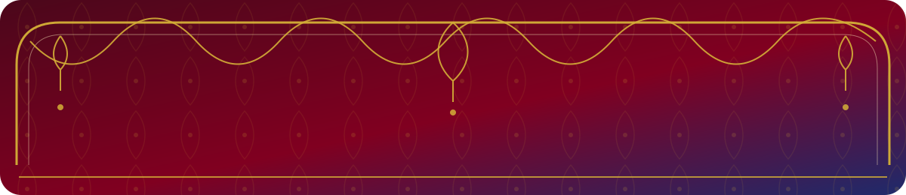
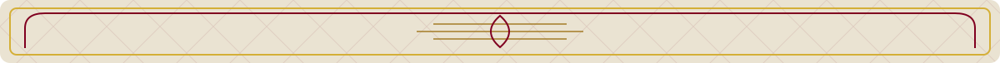
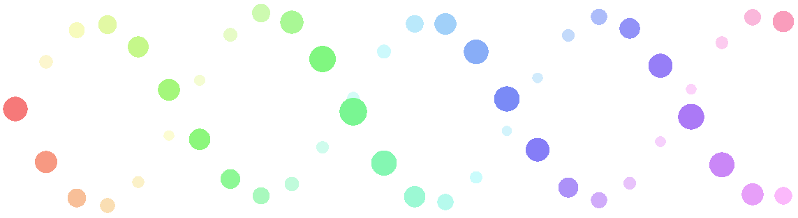
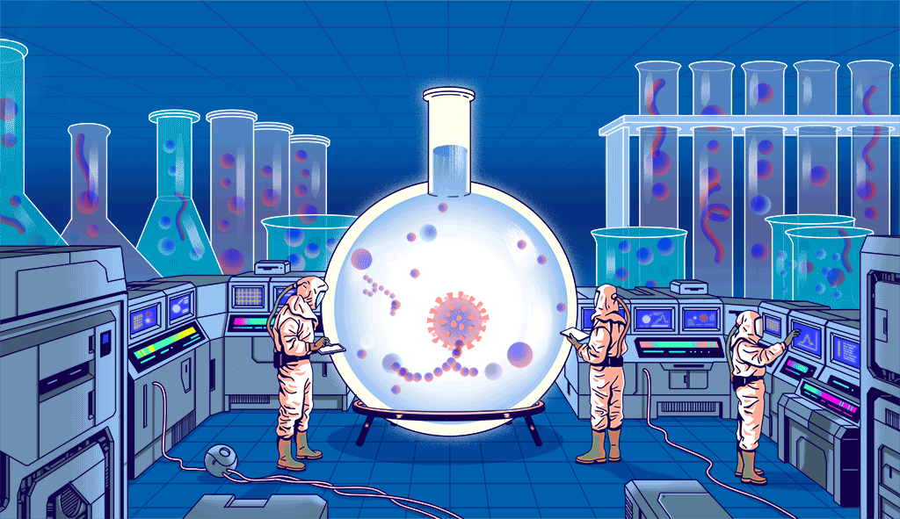
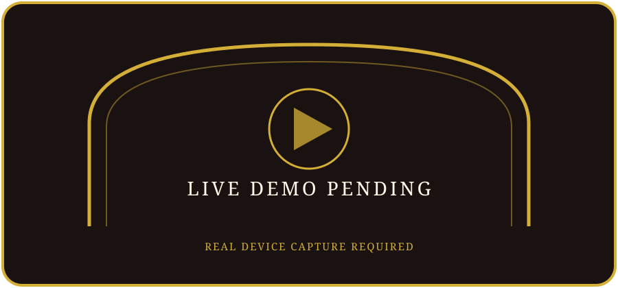
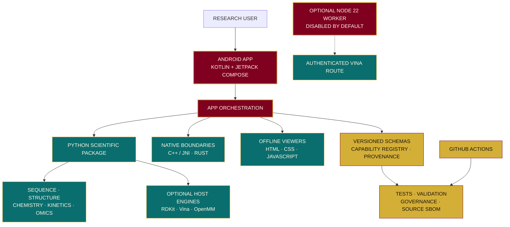
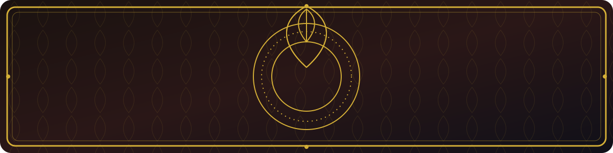
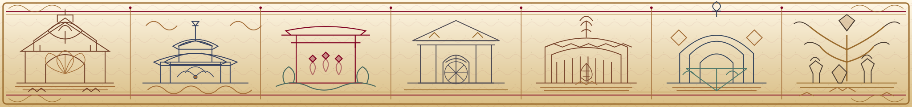

<p align="center">
  
</p>

<p align="center">
  
</p>

<p align="center">
  
  &nbsp;&nbsp;
  
  &nbsp;&nbsp;
  
</p>

<p align="center">
  
</p>

<p align="center">
  <a href="LICENSE"></a>
  
  <a href="https://github.com/AssayFlux/Kinetics/stargazers"></a>
  <a href="https://github.com/AssayFlux/Kinetics/issues"></a>
  <a href="https://img.shields.io/github/actions/workflow/status/AssayFlux/Kinetics/ci.yml?branch=main"></a>
</p>

<p align="center"><strong>PRE-RELEASE · RESEARCH USE ONLY · NOT CLINICALLY VALIDATED</strong></p>

---

<p align="center">
  
</p>

## 01 · PROJECT IDENTITY

**KINETICS** is an open-source, modular scientific research workbench from **ASSAYFLUX SCIENTIFIC SYSTEMS**. Its engineering direction is an **Android-native, offline-first** experience supported by a scientific Python package, selected C++ and Rust components, versioned contracts and reproducibility tooling.

The repository combines foundations for sequence analysis, structural biology, chemistry, molecular simulation, kinetics, pharmacokinetics/pharmacodynamics and omics. It is an evolving research-engineering prototype—not a clinically validated platform.

<p align="center">
  
</p>

<p align="center">
  
</p>

## 02 · SCIENTIFIC PHILOSOPHY

Kinetics is being built around a small set of non-negotiable principles:

| PRINCIPLE | ENGINEERING INTENT |
|---|---|
| **REPRODUCIBILITY** | Preserve inputs, parameters, units, software versions and method context. |
| **PROVENANCE** | Make the origin and transformation history of data and outputs inspectable. |
| **BOUNDED CAPABILITIES** | Declare what each tool accepts, returns, supports and does not support. |
| **OFFLINE-FIRST DESIGN** | Keep core workflows local where the implementation and target-device evidence support it. |
| **EVIDENCE BEFORE CLAIMS** | Separate source implementation, automated tests, independent scientific validation and device verification. |

<p align="center">
  
</p>

## 03 · ENGINEERING STATUS

The six-track sequence is controlled by **DECISIONS.md D-023** and **ROADMAP.md**.

| TRACK | SCOPE | CURRENT SOFTWARE STATUS |
|---|---|---|
| **R** | Research platform | **SOFTWARE AUDIT CLOSED** |
| **S** | Structure, sequence and discovery | **SOFTWARE SCOPE CLOSED** |
| **I** | In-silico laboratory | **SOFTWARE AUDIT CLOSED** |
| **P** | Precision-medicine research preparation | **IN PROGRESS** |
| **G** | Governance and assurance | **IN PROGRESS** |
| **U** | User interface and experience | **SEQUENCED AFTER G** |

**Execution order: R → S → I → P → G → U.**

- R, S and I are closed only for their documented software/audit scopes. Scientific, licensing, external-review and physical-device obligations remain separate carry-forward gates.
- P is still in progress. **P0 remains BLOCKED / NOT APPROVED.**
- G0–G7 engineering controls are being implemented and audited. Formal acceptance, independent reviews and operating exercises remain open.
- Existing U0–U3 work is retained as partial baseline material. Further sequential U implementation waits until G's gate is assessed.

No invented completion percentages are published. No overall scientific, clinical, regulatory or release-compliance percentage is claimed. The live CI badge reports workflow status; a passing build is not scientific validation or physical-device verification.

<p align="center">
  
</p>

## 04 · VISUAL GALLERY

<p align="center">
  
  <br>
  <sub><strong>BRAND ANIMATION · NOT AN APPLICATION WALKTHROUGH</strong></sub>
</p>

<table>
  <tr>
    <td align="center" width="50%">
      
      <br><strong>DASHBOARD DESIGN REFERENCE</strong>
    </td>
    <td align="center" width="50%">
      
      <br><strong>LOGIN DESIGN REFERENCE</strong>
    </td>
  </tr>
  <tr>
    <td align="center">
      
      <br><strong>LABORATORY VISUAL CONCEPT</strong>
    </td>
    <td align="center">
      
      <br><strong>LIVE APPLICATION DEMO · PENDING</strong>
    </td>
  </tr>
</table>

A verified Android device screenshot and application walkthrough will be added only after installation and runtime checks on a named target device. The standalone [DNA loader animation](assets/brand/kinetics_dna_loader.html) is a visual asset, not proof of an integrated application feature.

<p align="center">
  
</p>

## 05 · SCIENTIFIC CAPABILITIES

The following are source-backed repository foundations and integrations. Optional engines require separate installation and host configuration; their presence does not imply independent scientific validation.

| AREA | CURRENT REPOSITORY FOUNDATIONS |
|---|---|
| **SEQUENCE & GENOMICS** | FASTA/FASTQ parsing, sequence statistics, alignment and k-mer utilities; SAM/BAM/VCF foundations and variant normalisation. |
| **STRUCTURAL BIOLOGY** | PDB/mmCIF parsing, contact analysis, RMSD utilities and bounded structure-analysis foundations with an offline viewer. |
| **CHEMISTRY & DOCKING** | Molecular graph, SMILES and MOLBLOCK utilities; optional RDKit adapter and optional AutoDock Vina runner. |
| **MOLECULAR DYNAMICS** | Optional OpenMM runner with explicit setup and force-field limitations. |
| **KINETICS & PK/PD** | Michaelis–Menten models and exploratory pharmacokinetic/pharmacodynamic research utilities. |
| **OMICS & PHARMACOGENOMICS** | Exploratory omics statistics, synthetic cohort utilities and research-only pharmacogenomics parsing foundations. |
| **ANDROID WORKBENCH** | Kotlin and Jetpack Compose application foundation with local workflows and offline-first constraints. |
| **GOVERNANCE & PROVENANCE** | Capability registry, JSON Schema contracts, source inventory, validation records and governance controls. |

**IMPLEMENTED SOURCE DOES NOT MEAN EVERY ENGINE IS ENABLED, EVERY WORKFLOW IS COMPLETE, OR EVERY SCIENTIFIC METHOD HAS INDEPENDENT VALIDATION.**

<p align="center">
  
</p>

## 06 · TECHNOLOGY STACK

| LAYER | TECHNOLOGIES AND REPOSITORY EVIDENCE |
|---|---|
| **ANDROID / UI** | Kotlin, Jetpack Compose, AndroidX, Gradle and Chaquopy |
| **SCIENTIFIC CORE** | Python 3.10+, setuptools, pytest, Ruff and mypy |
| **NATIVE COMPUTE** | C++17, JNI/NDK and Rust toolchain |
| **OPTIONAL SCIENTIFIC ENGINES** | RDKit adapter, AutoDock Vina 1.2.7 and OpenMM 8.6.1 extras |
| **OFFLINE VIEWER** | HTML5, CSS, JavaScript and Android WebView |
| **OPTIONAL NODE WORKER** | Node.js 22+; dependency-free HTTP/TLS worker, disabled by default |
| **DATA & CONTRACTS** | SQLite, JSON Schema, YAML and SPDX source inventory |
| **BUILD & QUALITY** | GitHub Actions, Bash, CMake, Gradle and automated test tooling |

The declared Python distribution version in `pyproject.toml` is **0.0.0**. It is pre-release package metadata, not a public release announcement.

<p align="center">
  
</p>

## 07 · ARCHITECTURE

This is a repository-level component map. It does not imply that every optional engine, remote path or native boundary is enabled in the Android application.



**LANGUAGE OWNERSHIP:** Kotlin owns Android UI/platform orchestration; Python owns scientific workflows; Rust and C++ remain behind explicit native boundaries; WebView code is presentation-only. Cross-component messages use versioned contracts. See the [engineering integration standard](docs/ENGINEERING_INTEGRATION_STANDARD.md) and [architecture notes](docs/architecture.md).

<p align="center">
  
</p>

## 08 · QUICK START

### Prerequisites

- Python **3.10 or newer** for the declared Python package.
- Git and a virtual environment for Python development.
- Optional Android build host: **Linux x86_64 or x86_64 WSL2**, JDK 17, **Python 3.11.17 exactly**, Rust/Cargo, Android SDK platform 36, Build Tools 36.0.0, NDK 28.2.13676358, CMake 3.22.1, `patchelf` and `patch`.
- Optional Node worker tests: Node.js 22 or newer.
- The Android script downloads and verifies its pinned Gradle 8.13 distribution. Termux on Android is not a supported build host for this pinned x86_64 toolchain.

### Python installation

```bash
python -m venv .venv
source .venv/bin/activate
python -m pip install --upgrade pip
python -m pip install -r requirements-dev.txt
python -m pip install -e .
```

Windows PowerShell activation:

```powershell
.venv\Scripts\Activate.ps1
```

Optional engine extras:

```bash
python -m pip install -e ".[docking]"
python -m pip install -e ".[md]"
```

### Python usage

The package exports sequence helpers from `kinetics`. This source-backed example parses an in-memory FASTA string:

```python
from kinetics import parse_fasta

records = parse_fasta(">demo\nACGT")
print(records[0])
```

This example documents the public function shape; it was not executed as part of this README update. No root-level command-line application entry point is advertised.

### Tests and static checks

Commands defined in the checked-in CI workflow:

```bash
pytest
ruff check scripts tests
mypy scripts python/kinetics
python scripts/check_registry.py
python scripts/check_governance.py
scripts/reproduce-all
```

Optional Node worker tests:

```bash
cd remote-node
npm test
```

CI also defines pinned scientific reference comparisons, chemistry smoke fixtures, source SBOM inventory, Android arm64 debug packaging, JVM tests and package-alignment checks. Host smoke/reference checks are not independent biological or clinical validation and are not physical-device verification.

### Android debug build

On a supported Linux x86_64 / x86_64 WSL2 host with the prerequisites above:

```bash
chmod +x scripts/build_android_local.sh
scripts/build_android_local.sh
```

The script builds debug APK/AAB outputs and performs package-alignment checks. It does **not** install the application, run an emulator or verify a physical device. See the [local Android build guide](docs/local-android-build.md).

### Optional worker configuration

The optional research worker is disabled by default. Its configuration is documented in [remote-node/README.md](remote-node/README.md):

- `KINETICS_NODE_ALLOW_DOCKING`
- `KINETICS_NODE_AUTH_TOKEN`
- `KINETICS_NODE_HOST`
- `KINETICS_NODE_TLS_CERT`
- `KINETICS_NODE_TLS_KEY`

Keep secrets out of source control, shell history and issue attachments.

<p align="center">
  
</p>

## 09 · REPOSITORY STRUCTURE

```text
Kinetics/
├── android/                 # Kotlin app, Compose, JNI, Rust and embedded Python
├── api/                     # Versioned API, message and evidence contracts
├── assets/                  # Canonical brand artwork and design references
│   ├── brand/               # Original logos, signature and animations
│   ├── cards/               # README information cards and placeholders
│   ├── design-previews/     # Owner-supplied visual references
│   └── ornaments/           # Original manuscript, toran and chapter SVGs
├── benchmarks/              # Benchmark protocols and fixtures
├── capabilities/            # Capability registry and status metadata
├── cpp/                     # Native C++ implementation
├── data/                    # Source catalogues and metadata
├── datapacks/               # Data-pack manifests and planned payloads
├── design/                  # Design tokens and generated design inputs
├── docs/                    # Architecture, audits, track plans and UI specs
├── domains/                 # Scientific domain metadata
├── engines/                 # Engine metadata and integration points
├── governance/              # Governance and assurance registers
├── paper/                   # Manuscript planning and claim-evidence ledger
├── python/kinetics/         # Scientific Python package
├── remote-node/             # Optional, disabled-by-default Node worker
├── rust/                    # Rust source and integration area
├── schemas/                 # Reusable domain and data schemas
├── scripts/                 # Build, generation, validation and inventory
├── sbom/                    # Software bill-of-materials materials
├── tests/                   # Python regression and contract tests
├── validation/              # Pinned reference and engine smoke checks
├── web/viewers/             # Offline HTML/CSS/JavaScript viewers
├── .github/workflows/       # GitHub Actions CI
├── pyproject.toml           # Python package metadata and tool configuration
├── requirements-dev.txt     # Development dependencies
├── ROADMAP.md               # Canonical track plan
├── DECISIONS.md              # Owner decisions and supersession history
├── NORTH_STAR.md             # Mission, boundaries and direction
└── LICENSE                   # Apache License 2.0
```

This is a documentation-level map of the main areas, not a claim that every directory contains a complete product module. The [documentation index](docs/README.md) is the canonical navigation guide.

<p align="center">
  
</p>

## 10 · API AND RESEARCH BOUNDARIES

- The Python library is packaged from `python/` and imported as `kinetics`.
- Versioned API/message and evidence contracts live in `api/`; reusable domain/data schemas live in `schemas/`.
- The optional Node worker is a private research-compute boundary, not a public API. Its documented routes are `GET /health` and bearer-authenticated `POST /v1/docking`.
- The worker binds to loopback by default; docking is disabled unless explicitly enabled. The service does not expose molecular-dynamics execution.
- No production service deployment, public API availability or independent docking validity is claimed.
- No patient/clinical data, human-subject activity, individual clinical/PGx interpretation, diagnosis, treatment/dosing recommendation or Clinical Mode is authorized.

<p align="center">
  
</p>

<p align="center">
  
</p>

## 11 · ROADMAP

The current sequential order is **R → S → I → P → G → U**, under D-023.

| TRACK | DIRECTION | GATE |
|---|---|---|
| **R** | Research platform foundations | Software audit closed; external evidence remains carry-forward. |
| **S** | Structure, sequence and discovery | Software scope closed; independent references, licensing and device evidence remain open. |
| **I** | In-silico laboratory | Software audit closed; scientific benchmarks, licensing and device evidence remain open. |
| **P** | Permitted research-only engineering base | In progress; **P0 BLOCKED / NOT APPROVED**; external and acceptance gates remain open. |
| **G** | Governance, assurance and publication integrity | In progress; exact engineering acceptance, independent reviews and operating evidence remain open. |
| **U** | User interface and experience | Sequenced after G; existing U0–U3 work remains partial baseline, not accepted completion. |

Further roadmap work includes capability-level independent scientific reference evidence, data/model/dependency licensing decisions, release-grade SBOM coverage, physical Android device and offline workflow verification, and a real application demo after verified installation.

The [canonical roadmap](ROADMAP.md) and [decision log](DECISIONS.md) remain authoritative. The README does not replace their phase-level exit criteria.

<p align="center">
  
</p>

## 12 · CONTRIBUTION AND LICENSING

Before proposing work:

1. Read [NORTH_STAR.md](NORTH_STAR.md), [ROADMAP.md](ROADMAP.md) and [DECISIONS.md](DECISIONS.md).
2. Read [CONTRIBUTING.md](CONTRIBUTING.md) and the [engineering integration standard](docs/ENGINEERING_INTEGRATION_STANDARD.md).
3. Work only on an active, permitted item and respect the sequential track gates.
4. Add or update tests, schemas, provenance and licensing evidence alongside implementation.
5. Report checks run, checks not run, limitations and the next step. Never claim scientific or device validation without evidence.

**LICENSE:** Kinetics is distributed under the **Apache License 2.0**. Third-party dependencies, engines, datasets, models, fonts and visual assets may carry separate licensing and redistribution conditions. Review their upstream terms before bundling or redistribution.

<p align="center">
  
</p>

## 13 · ACKNOWLEDGEMENTS

<p align="center">
  🪷 **WITH GRATITUDE TO THE OPEN-SOURCE SCIENTIFIC, BIOINFORMATICS, ANDROID AND DEVELOPER-TOOL COMMUNITIES WHO MAKE REPRODUCIBLE RESEARCH POSSIBLE.** 🪔
</p>

<p align="center">
  
</p>

## 14 · FINAL ROYAL SEAL

<p align="center">
  
</p>

<p align="center">
  
</p>

<p align="center">
  <strong>ASSAYFLUX SCIENTIFIC SYSTEMS</strong><br>
  <em>LET EVERY HELIX CARRY A QUESTION, AND EVERY ANSWER ITS EVIDENCE.</em><br>
  <sub>BUILT WITH CURIOSITY · GOVERNED BY EVIDENCE · OPEN TO HUMAN KNOWLEDGE</sub>
</p>

---

<p align="center">
  
</p>
