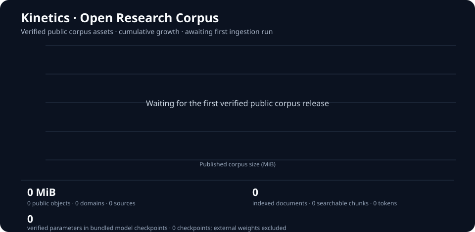

<p align="center">
  
</p>
<p align="center">
  
</p>

<h1 align="center">KINETICS</h1>
<p align="center"><strong>CONNECTING SCIENCE · ADVANCING HEALTH · PROTECTING HUMANITY</strong></p>
<p align="center">An evidence-centred platform for connected biomedical research.</p>

<p align="center">
  
  
  
  
  
</p>

---

## What is Kinetics?

**Kinetics** is an open research-platform project bringing biological data, computational methods and scientific evidence into a coherent, reproducible environment.

The platform is being built in stages: integrate the scientific and infrastructure foundations first, develop the application on top of them, then complete real-data testing, researcher training and acceptance. The repository is an evolving engineering foundation—not a claim that every planned domain or clinical capability is complete.

| Principle | What it means |
|---|---|
| Evidence first | Results retain source, method, version and provenance |
| Reproducibility | Data transformations and model runs are traceable |
| Interoperability | Explicit schemas, identifiers, units and adapters |
| Responsible use | Uncertainty, privacy and human oversight are built into the workflow |

## Platform capabilities

| Area | Available foundation | Next validation milestone |
|---|---|---|
| Scientific data | Ingestion, normalization, provenance and quality-audit utilities | Reviewed, licensed real-world datasets and source audits |
| Bioinformatics & chemistry | Protein and molecular feature pipelines, including ESM-2 configuration and Morgan fingerprints | Reproducible execution and benchmark results on reviewed data |
| Modelling & evaluation | Baselines, feature-fusion model and leakage-aware split utilities | Frozen benchmarks, external validation and statistical review |
| Research workbench | Local-first browser interface, project workspaces, jobs and artifacts | Researcher, accessibility, installation and real-data acceptance |
| Molecular structures | C++17 PDB parsing and molecular scene-data foundation | Broader structure formats, independent validation and interactive rendering |
| Platform services | Rust foundations for identity, jobs, artifacts and audit; AWS deployment configuration | Live deployment, scientific workers, isolation, security and recovery tests |

**Scope note:** these are implementation foundations, not claims of production deployment, clinical validation or scientific performance. The 160-domain catalogue describes intended scope; it does not mean 160 finished modules.

## Scientific scope

Kinetics is designed to span 160 scientific, biomedical, engineering, computing and natural-science acquisition domains (100 foundational domains plus 60 extensions). The canonical domain register, grouped taxonomy and scope notes are maintained in [`docs/SCIENCE_DOMAIN_CATALOGUE_100.md`](docs/SCIENCE_DOMAIN_CATALOGUE_100.md). Catalogue inclusion describes intended scope only; it does not imply that a domain-specific module is implemented, tested or clinically validated.

## Architecture at a glance

| Layer | Responsibility | Main technologies |
|---|---|---|
| Scientific core | Data processing, curation, features, modelling and validation | Python |
| Infrastructure | Identity, job lifecycle, artifact handling and audit foundations | Rust |
| Native science | Molecular structure parsing and scene data | C++17 |
| Local persistence | Workbench state and scientific metadata | SQLite |
| Deployment path | Candidate cloud infrastructure and managed services | AWS / Terraform |
| Research interface | Local-first workbench and future application surfaces | FastAPI / web UI |

## Get started

**Requirements:** Python 3.10 or newer.

```bash
git clone https://github.com/AssayFlux/Kinetics.git
cd Kinetics

python -m venv .venv
source .venv/bin/activate

python -m pip install --upgrade pip
python -m pip install -e ".[dev,workbench]"
```

Start the local research workbench:

```bash
kinetics-workbench
```

Then open **http://127.0.0.1:8765**.

The workbench currently binds to loopback and is intended for local, single-user use. Do not expose it to the public internet or a shared network.

Explore available commands:

```bash
kinetics-research --help
```

Optional modelling dependencies:

```bash
python -m pip install -e ".[baseline]"
```

## Project status

**Current phase: integration and acceptance preparation.** The priority is to complete and validate the foundations before building out the full application.

| Workstream | Current position | Outstanding evidence |
|---|---|---|
| Scientific pipelines | Core utilities and test fixtures exist | Licensed datasets, end-to-end real-data runs and reproducibility |
| Modelling | Baseline and feature-fusion components exist | ESM-2/MMseqs2 execution, frozen benchmarks and external validation |
| Molecular engine | PDB and scene-data foundation exists | Independent structure validation and full renderer/engine integration |
| Infrastructure | Rust service foundations and cloud configuration exist | Production deployment, scientific worker isolation, tenant security and recovery drills |
| Workbench | Local-first interface exists | Researcher and accessibility acceptance across supported devices |
| Release readiness | Release gates and evidence requirements are documented | SBOM, security review, evidence archive and signed release approval |

A passing test suite or CI run verifies only the behaviours covered by those tests. It does not establish scientific validity, production readiness or clinical performance.

## Quality checks

Run the Python tests:

```bash
python -m pytest -q
```

Run linting:

```bash
python -m ruff check src tests
```

Native and Rust checks:

```bash
cmake -S native -B build/native
cmake --build build/native
ctest --test-dir build/native --output-on-failure

cd rust/kinetics-infra
cargo fmt --all -- --check
cargo clippy --all-targets -- -D warnings
cargo test --all-targets
```

Some integration checks require optional dependencies or local services.

## Documentation

| Document | Purpose |
|---|---|
| [KINETICS_MISSION.md](KINETICS_MISSION.md) | Authoritative mission and project boundaries |
| [VISION.md](VISION.md) | Long-term scientific and product vision |
| [ROADMAP.md](ROADMAP.md) | Fifteen long-term programmes and dependencies |
| [ARCHITECTURE.md](ARCHITECTURE.md) | System architecture and component boundaries |
| [ENGINEERING_STACK.md](ENGINEERING_STACK.md) | Technology responsibilities and engineering standards |
| [docs/DOCUMENTATION_INDEX.md](docs/DOCUMENTATION_INDEX.md) | Complete maintained documentation map |
| [docs/DOCUMENTATION_GOVERNANCE.md](docs/DOCUMENTATION_GOVERNANCE.md) | Documentation authority and consistency audit |
| [docs/KINETICS_10_STEP_COMPLETION_PROGRAMME.md](docs/KINETICS_10_STEP_COMPLETION_PROGRAMME.md) | Active engineering completion programme |
| [docs/IMPLEMENTATION_STATUS.md](docs/IMPLEMENTATION_STATUS.md) | Current implementation snapshot and blockers |
| [docs/IMPLEMENTATION_HISTORY.md](docs/IMPLEMENTATION_HISTORY.md) | Preserved historical implementation notes |
| [docs/SCIENCE_DOMAIN_CATALOGUE_100.md](docs/SCIENCE_DOMAIN_CATALOGUE_100.md) | Complete scientific domain catalogue |
| [docs/WORKFLOW.md](docs/WORKFLOW.md) | End-to-end enzyme-kinetics research workflow |
| [docs/WORKBENCH_GUIDE.md](docs/WORKBENCH_GUIDE.md) | Setup, usage and workbench boundaries |
| [docs/STEP7_PRODUCTION_ACCEPTANCE.md](docs/STEP7_PRODUCTION_ACCEPTANCE.md) | Infrastructure and production acceptance criteria |
| [docs/STEP10_RELEASE_READINESS_GATES.md](docs/STEP10_RELEASE_READINESS_GATES.md) | Release evidence and go/no-go requirements |

## Responsible research

Kinetics is research and engineering infrastructure—not a diagnostic device, treatment recommendation system or substitute for qualified medical judgement. Use only data with appropriate rights and authorization. Protect identifiable, genetic and other sensitive information; preserve source attribution, consent restrictions and provenance. Treat model outputs as estimates, retain uncertainty and require qualified human review for consequential interpretation.

## Contributing

Contributions should include tests, clear documentation and evidence for scientific or operational claims. Preserve data provenance, licensing, reproducibility and the explicit limits of each capability. Review `docs/CONTRIBUTING.md` and the repository `LICENSE` before contributing.

---

<p align="center"><strong>KINETICS</strong><br>
<sub>Connect knowledge. Preserve evidence. Build responsibly.</sub></p>


## Knowledge corpus ingestion

### Live corpus growth

The graph below is generated from the ingestion manifest and SQLite index after each successful corpus synchronization. It tracks **cumulative, verified objects published as public GitHub Release assets**—not planned download limits or unverified downloads. The latest-workflow index figures are shown separately so a temporary build index is not mistaken for the entire accumulated archive. Model parameters are separated by availability: Kinetics configures the external `facebook/esm2_t6_8M_UR50D` encoder (approximately **8 million parameters**, downloaded on first use), while bundled checkpoint parameters are counted separately and remain zero until weights are actually committed. The registry is `data/model-manifests/model_registry.json`.

<p align="center">
  
</p>

- **Public corpus:** downloadable release-published objects with recorded source, licence, size and checksum.
- **Latest workflow index:** documents, searchable chunks and tokenizer counts in the SQLite database produced by the latest ingestion workflow. Download the database from that run's **knowledge-ingestion-diagnostics** artifact; artifacts are retained for 30 days.
- The chart updates automatically during ingestion synchronization. If no verified release assets exist yet, it explicitly shows that the first release is pending. The dashboard reports bundled checkpoint parameters separately from configured external model parameters. The configured ESM-2 model is approximately 8M parameters; its weights are downloaded on first use and are not included in repository storage.

Open [corpus ingestion runs and artifacts](https://github.com/AssayFlux/Kinetics/actions/workflows/bulk_downloader.yml) to download the latest database and inspect build logs.

Kinetics includes an incremental, license-aware knowledge ingestion pipeline
covering a unified 160-domain catalogue: 100 foundational biomedical/healthcare domains plus 60 cross-disciplinary extensions. It discovers and acquires
redistributable books and biomedical papers in bounded batches, preserves
source/license/checksum provenance, and builds a local searchable text index.

~~~bash
python -m pip install -r requirements-knowledge.txt
python -m pip install -e . --no-deps
python scripts/fetch_corpus.py --dry-run
python scripts/fetch_corpus.py --batch-size 15 --max-batch-mb 40
python scripts/fetch_research_data.py --batch-size 15 --max-batch-mb 40
python scripts/tokenize_corpus.py --max-documents 100
python scripts/analyze_corpus.py
python scripts/query_knowledge.py "cardiac AND imaging" --limit 10
kinetics-knowledge "cardiac AND imaging" --limit 10
~~~

Raw files are stored locally under **data/corpus/objects/**; the resumable,
versioned source manifest is **data/corpus-manifests/metadata_index.json**.
The metadata/chunk index is stored in the existing local **data/kinetics.sqlite3**
database. The corpus is not committed as ordinary Git blobs.

The GitHub Actions workflow **.github/workflows/bulk_downloader.yml** runs
two bounded cycles per week and can also be started from **Actions → Kinetics
knowledge corpus ingestion → Run workflow**. Manual runs support up to three cycles of 90 records each
and a combined ceiling of 1,536 MiB per cycle (up to 4.5 GiB in configured transfer
budgets per run). Individual source objects remain capped at 80 MiB for release
packaging. These are ceilings, not guaranteed throughput; source availability,
rate limits, licensing and runner time determine actual downloads. It publishes
licensed corpus batches as GitHub Release assets by default and commits compact manifests.
Restore the release assets into a local checkout before indexing the complete
remote corpus:

~~~bash
gh auth login
python scripts/restore_corpus_releases.py
python scripts/tokenize_corpus.py --max-documents 10000
python scripts/analyze_corpus.py
~~~

Git LFS is also supported with **python scripts/git_sync.py --mode lfs --push**,
but it has separate storage and bandwidth quotas. Use it only after checking
your account limits. Review **docs/KNOWLEDGE_INGESTION.md** for source rights,
privacy rules, restore procedures, workflow settings and limitations. Unknown,
non-commercial, no-derivatives and all-rights-reserved content is not mirrored.
Never put patient data, secrets or restricted documents in this public repo.
